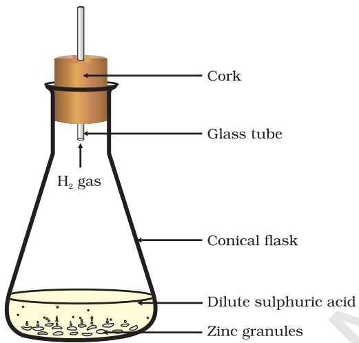

**You must have observed that magnesium ribbon burns with a dazzling white flame and changes into a white powder. This powder is magnesium oxide. It is formed due to the reaction between magnesium and oxygen present in the air.**

## Activity 1.2

**Take lead nitrate solution in a test tube.**

**Add potassium iodide solution to this.**

**What do you observe?**

Figure 1.2 Formation of hydrogen gas by the action of dilute sulphuric acid on zinc

## Activity 1.3

n **Take a few zinc granules in a conical flask or a test tube.**

**Add dilute hydrochloric acid or sulphuric acid to this (Fig. 1.2).**

**CAUTION: Handle the acid with care.**

**Do you observe anything happening around the zinc granules?**

**Touch the conical flask or test tube. Is there any change in its temperature?**

**From the above three activities, we can say that any of the following observations helps us to determine whether a chemical reaction has taken place –**

n **change in state**

n **change in colour**

n **evolution of a gas**

n **change in temperature.**

**As we observe the changes around us, we can see that there is a large variety of chemical reactions taking place around us. We will study about the various types of chemical reactions and their symbolic representation in this Chapter.**

## 1.1 CHEMICAL EQUA TIONS

**Activity 1.1 can be described as – when a magnesium ribbon is burnt in oxygen, it gets converted to magnesium oxide. This description of a chemical reaction in a sentence form is quite long. It can be written in a shorter form. The simplest way to do this is to write it in the form of a word-equation.**

**The word-equation for the above reaction would be –**

$$
\begin{array} { c c c } { { \mathrm { M a g n e s i u m } + \mathrm { O x y g e n } } } & { { \rightarrow } } & { { \mathrm { M a g n e s i u m ~ o x i d e } } } \\ { { \mathrm { ( R e a c t a n t s ) } } } & { { } } & { { \mathrm { ( P r o d u c t ) } } } \end{array}\tag{1.1}
$$

**The substances that undergo chemical change in the reaction (1.1), magnesium and oxygen, are the reactants. The new substance is magnesium oxide, formed during the reaction, as a product.**

**A word-equation shows change of reactants to products through an arrow placed between them. The reactants are written on the left-hand side (LHS) with a plus sign (+) between them. Similarly, products are written on the right-hand side (RHS) with a plus sign (+) between them. The arrowhead points towards the products, and shows the direction of the reaction.**