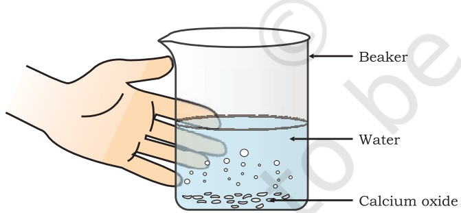

**1. Why should a magnesium ribbon be cleaned before burning in air?**

**2. Write the balanced equation for the following chemical reactions.**

**(i) Hydrogen + Chlorine → Hydrogen chloride**

**(ii) Barium chloride + Aluminium sulphate → Barium sulphate + Aluminium chloride**

**(iii) Sodium + Water → Sodium hydroxide + Hydrogen**

**3. Write a balanced chemical equation with state symbols for the following reactions.**

**(i) Solutions of barium chloride and sodium sulphate in water react to give insoluble barium sulphate and the solution of sodium chloride.**

**(ii) Sodium hydroxide solution (in water) reacts with hydrochloric acid solution (in water) to produce sodium chloride solution and water.**

## 1.2 TYPES OF CHEMICAL REACTIONS

**We have learnt in Class IX that during a chemical reaction atoms of one element do not change into those of another element. Nor do atoms disappear from the mixture or appear from elsewhere. Actually, chemical reactions involve the breaking and making of bonds between atoms to produce new substances. You will study about types of bonds formed between atoms in Chapters 3 and 4.**

## 1.2.1 Combination Reaction

Figure 1.3

Formation of slaked lime by the reaction of calcium oxide with water

## Activity 1.4

**Take a small amount of calcium oxide or quick lime in a beaker.**

n **Slowly add water to this.**

**Touch the beaker as shown in Fig. 1.3.**

n **Do you feel any change in temperature?**

**Calcium oxide reacts vigorously with water to produce slaked lime (calcium hydroxide) releasing a large amount of heat.**

$$
\begin{array} { r l r } & { \mathrm { C a O ( s ) \quad + \quad H _ { 2 } O ( l ) \quad \rightarrow C a ( O H ) _ { 2 } ( a q ) \quad + \quad H e a t } } \\ & { \mathrm { ( \mathbb { Q } u i c k ~ l i m e ) \quad ( S l a k e d ~ l i m e ) } } \end{array}\tag{1.13}
$$

**In this reaction, calcium oxide and water combine to form a single product, calcium hydroxide. Such a reaction in which a single product is formed from two or more reactants is known as a combination reaction.**