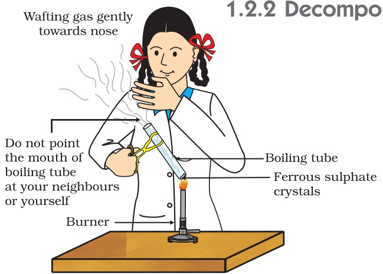
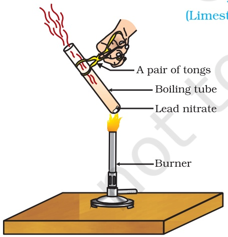

## 1.2.2 Decomposition Reaction

Figure 1.4 Correct way of heating the boiling tube containing crystals of ferrous sulphate and of smelling the odour

## Activity 1.5

Take about $^ { 2 } \mathrm { ~ g ~ }$ **ferrous sulphate crystals in a dry boiling tube.**

**Note the colour of the ferrous sulphate crystals.**

**Heat the boiling tube over the flame of a burner or spirit lamp as shown in Fig. 1.4.**

**Observe the colour of the crystals after heating.**

**Have you noticed that the green colour of the ferrous sulphate crystals has changed? You can also smell the characteristic odour of burning sulphur.**

$$
\begin{aligned}& 2FeSO _4 (s)  \xrightarrow{\quad  Heat  \quad}  Fe _2 O _3 (s)  +  SO _2 (g)  +  SO _3 (g)  \\& (Ferrous subplate)  \quad (Ferric acide) \end{aligned}\tag{1.19}
$$

**In this reaction you can observe that a single reactant breaks down to give simpler products. This is a decomposition reaction. Ferrous** sulphate crystals (FeSO $\mathrm{7H_{2}O}$ **lose water when heated and the colour** of the crystals changes. It then decomposes to ferric oxide $\mathrm { ( F e _ { 2 } O _ { 3 } ) }$ sulphur dioxide $( \mathrm { S O _ { 2 } } )$ and sulphur trioxide $( \mathrm { S O _ { 3 } } )$ **. Ferric oxide is a solid,** while $\mathrm { S O _ { 2 } }$ and $\mathrm{SO_{3}}$ **are gases.**

**Decomposition of calcium carbonate to calcium oxide and carbon dioxide on heating is an important decomposition reaction used in various industries. Calcium oxide is called lime or quick lime. It has many uses – one is in the manufacture of cement. When a decomposition reaction is carried out by heating, it is called thermal decomposition.**

$$
\mathrm{CaCO_{3}(s) \xrightarrow{Heat} CaO(s) + CO_{2}(g)}\tag{1.20}
$$

**(Limestone)**

Figure 1.5 Heating of lead nitrate and emission of nitrogen dioxide

**(Quick lime)**

**Another example of a thermal decomposition reaction is given in Activity 1.6.**

## Activity 1.6

Take about $^ { 2 } \mathrm { ~ g ~ }$ **lead nitrate powder in a boiling tube.**

**Hold the boiling tube with a pair of tongs and heat it over a flame, as shown in Fig. 1.5.**

**What do you observe? Note down the change, if any.**

**You will observe the emission of brown fumes.** These fumes are of nitrogen dioxide $( \mathrm { N O } _ { 2 } )$ **. The reaction that takes place is –**