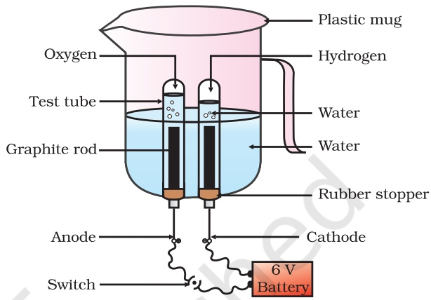
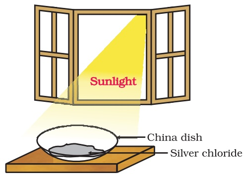

$$
\begin{array}{l}\text { (2Pb(NO ) _3 (s) } \quad \text { Hect } \quad \text { ) } \quad \text { 2PbO(s) } \quad + \quad \text { 4NO _2 (g) } \quad + \quad \text { O _2 (g) } \\\text { (Lcali n i t r a t e) } \quad \text { (Lcalo d~oxidc) } \quad \text { (Nitogcn } \quad \text { (Oxgcni) } \\\quad \text { (Lcali c) }\end{array}\tag{1.21}
$$

**Let us perform some more decomposition reactions as given in Activities 1.7 and 1.8.**

## Activity 1.7

**Take a plastic mug. Drill two holes at its base and fit rubber stoppers in these holes. Insert carbon electrodes in these rubber stoppers as shown in Fig. 1.6.**

**Connect these electrodes to a 6 volt battery.**

**Fill the mug with water such that the electrodes are immersed. Add a few drops of dilute sulphuric acid to the water.**

**Take two test tubes filled with water and invert them over the two carbon electrodes.**

**Switch on the current and leave the apparatus undisturbed for some time.**

n **You will observe the formation of bubbles** **at both the electrodes. These bubbles displace water in the test tubes.**

Figure 1.6 Electrolysis of water

n **Is the volume of the gas collected the same in both the test tubes?**

**Once the test tubes are filled with the respective gases, remove them carefully.**

**Test these gases one by one by bringing a burning candle close to the mouth of the test tubes.**

**CAUTION: This step must be performed carefully by the teacher.**

n **What happens in each case?**

n **Which gas is present in each test tube?**

## Activity 1.8

n **Take about 2 g silver chloride in a china dish.**

n **What is its colour?**

**Place this china dish in sunlight for some time (Fig. 1.7).**

**Observe the colour of the silver chloride after some time.**

Figure 1.7

**You will see that white silver chloride turns grey in sunlight. This is due to the decomposition of silver chloride into silver and chlorine by light.**

Silver chloride turns grey in sunlight to form silver metal

$$
\mathrm { 2 A g C l ( s ) \xrightarrow { \quad S u n l i g h t \quad } 2 A g ( s ) + C l _ { 2 } ( g ) }\tag{1.22}
$$