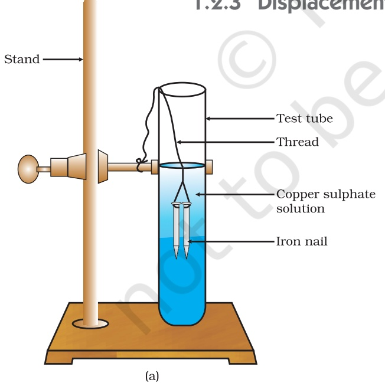

**Silver bromide also behaves in the same way.**

$$
2AgBr(s)  \xrightarrow{\quad  Sumlight \quad}  2Ag(s)  +  Br _2 (g)\tag{1.23}
$$

**The above reactions are used in black and white photography. What form of energy is causing these decomposition reactions?**

**We have seen that the decomposition reactions require energy either in the form of heat, light or electricity for breaking down the reactants. Reactions in which energy is absorbed are known as endothermic reactions.**

## Carry out the following Activity

**Take about 2 g barium hydroxide in a test tube. Add 1 g of ammonium chloride and mix with the help of a glass rod. Touch the bottom of the test tube with your palm. What do you feel? Is this an exothermic or endothermic reaction?**

## Q U E S T I O N S

**1. A solution of a substance ‘X’ is used for whitewashing.**

**(i) Name the substance ‘X’ and write its formula.**

**(ii) Write the reaction of the substance ‘X’ named in (i) above with water.**

**2. Why is the amount of gas collected in one of the test tubes in Activity 1.7 double of the amount collected in the other? Name this gas.**

## 1.2.3 Displacement Reaction

Figure 1.8

(a) Iron nails dipped in copper sulphate solution

## Activity 1.9

**Take three iron nails and clean them by rubbing with sand paper.**

**Take two test tubes marked as (A) and (B). In each test tube, take about 10 mL copper sulphate solution.**

**Tie two iron nails with a thread and immerse them carefully in the copper sulphate solution in test tube B for about 20 minutes [Fig. 1.8 (a)]. Keep one iron nail aside for comparison.**

**After 20 minutes, take out the iron nails from the copper sulphate solution.**

**Compare the intensity of the blue colour of copper sulphate solutions in test tubes (A) and (B) [Fig. 1.8 (b)].**

**Also, compare the colour of the iron nails dipped in the copper sulphate solution with the one kept aside [Fig. 1.8 (b)].**