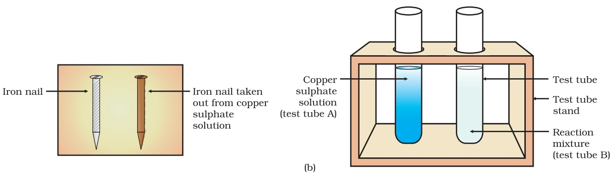
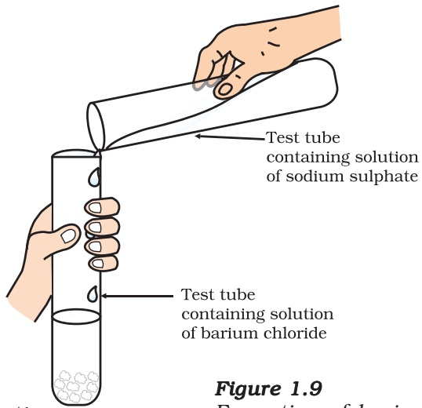

Figure 1.8 (b) Iron nails and copper sulphate solutions compared before and after the experiment

**Why does the iron nail become brownish in colour and the blue colour of copper sulphate solution fades?**

**The following chemical reaction takes place in this Activity–**

$$
\begin{array}{rcl}\mathrm{Fe(s)} + \mathrm{CuSO_4(aq)} \rightarrow & \quad \mathrm{FeSO_4(aq)} \quad + \quad \mathrm{Cu(s)} \\(\mathrm{Copper} \text {splitate}) & \quad (\mathrm{from} \text {splitate})\end{array}\tag{1.24}
$$

**In this reaction, iron has displaced or removed another element, copper, from copper sulphate solution. This reaction is known as displacement reaction.**

**Other examples of displacement reactions are**

$$
\begin{array} { r l } { \mathrm { Z n ( s ) + C u S O _ { 4 } ( a q ) \rightarrow Z n S O _ { 4 } ( a q ) + C u ( s ) } } \\ { \mathrm { ( C o p p e r ~ s u l p h a t e ) \quad ( Z i n c ~ s u l p h a t e ) } \quad , } \end{array}\tag{1.25}
$$

$$
\begin{array}{ccc}\mathrm{Pb(s)} + \mathrm{CuCl_2(aq)} & \rightarrow & \mathrm{PbCl_2(aq)} \quad \pm \quad \mathrm{Cu(s)} \\(\mathrm{Coper} \; \mathrm{cholrede}) & (\mathrm{Lead} \; \mathrm{cholrede}) & \quad  尐 \end{array}\tag{1.26}
$$

**Zinc and lead are more reactive elements than copper. They displace copper from its compounds.**

## 1.2.4 Double Displacement Reaction

## Activity 1.10

**Take about 3 mL of sodium sulphate solution in a test tube.**

**In another test tube, take about 3 mL of barium chloride solution.**

n **Mix the two solutions (Fig. 1.9).**

n **What do you observe?**

**You will observe that a white substance, which is insoluble in water, is formed. This insoluble substance formed is known as a precipitate. Any reaction that** produces a precipitate can be called a precipitation reaction

$$
\begin{array}{l}\mathrm{Na}_{2}\mathrm{SO}_{4}(\mathrm{aq})+\mathrm{BaCl}_{2}(\mathrm{aq}) \rightarrow \mathrm{BaSO}_{4}(\mathrm{s})+2 \mathrm{NaCl}(\mathrm{aq}) \\(\mathrm{SOdim} \quad \text { (Barium } \quad \text { (Barium } \quad \text { (SOdim) } \\\text { subplate) } \quad \text { (hioride) } \quad \text { subplate) } \quad \text { (hioride) }\end{array}
$$

**(1.27)**

**Formation of barium sulphate and sodium chloride**