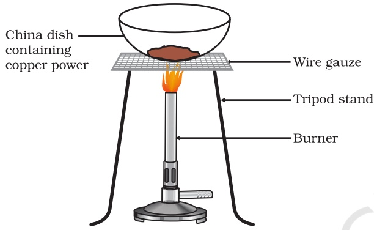
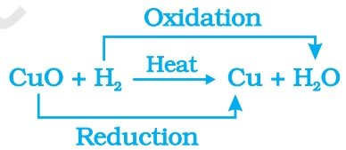

**What causes this? The white precipitate of** $\mathrm{BaSO_{4}}$ **is formed by the reaction of** $\mathrm { S O } _ { 4 } ^ { 2 - }$ and $\mathrm { B a ^ { 2 + } }$ **. The other product formed is sodium chloride which remains in the solution. Such reactions in which there is an exchange of ions between the reactants are called double displacement reactions.**

**Recall Activity 1.2, where you have mixed the solutions of lead(II) nitrate and potassium iodide.**

**(i) What was the colour of the precipitate formed? Can you name the compound precipitated?**

**(ii) Write the balanced chemical equation for this reaction.**

**(iii) Is this also a double displacement reaction?**

## 1.2.5 Oxidation and Reduction

Figure 1.10 Oxidation of copper to copper oxide

## Activity 1.11

**Heat a china dish containing about 1 g copper powder (Fig. 1.10).**

n **What do you observe?**

**The surface of copper powder becomes coated with black copper(II) oxide. Why has this black substance formed?**

**This is because oxygen is added to copper and copper oxide is formed.**

$$
2Cu+O_{2}\xrightarrow{   }2CuO\tag{1.28}
$$

**If hydrogen gas is passed over this heated material (CuO), the black coating on the surface turns brown as the reverse reaction takes place and copper is obtained.**

$$
\mathrm{CuO}+\mathrm{H}_{2} \xrightarrow{\mathrm{Hcat}} \mathrm{Cu}+\mathrm{H}_{2}\mathrm{O}\tag{1.29}
$$

**If a substance gains oxygen during a reaction, it is said to be oxidised. If a substance loses oxygen during a reaction, it is said to be reduced.**

**During this reaction (1.29), the copper(II) oxide is losing oxygen and is being reduced. The hydrogen is gaining oxygen and is being oxidised. In other words, one reactant gets oxidised while the other gets reduced during a reaction. Such reactions are called oxidation-reduction reactions or redox reactions.**

**(1.30)**

**Some other examples of redox reactions are:**

$$
\mathrm{ZnO}+\mathrm{C} \rightarrow \mathrm{Zn}+\mathrm{CO}\tag{1.31}
$$

$$
\mathrm{MnO_{2}+4HCl\rightarrow MnCl_{2}+2H_{2}O+Cl_{2}}\tag{1.32}
$$