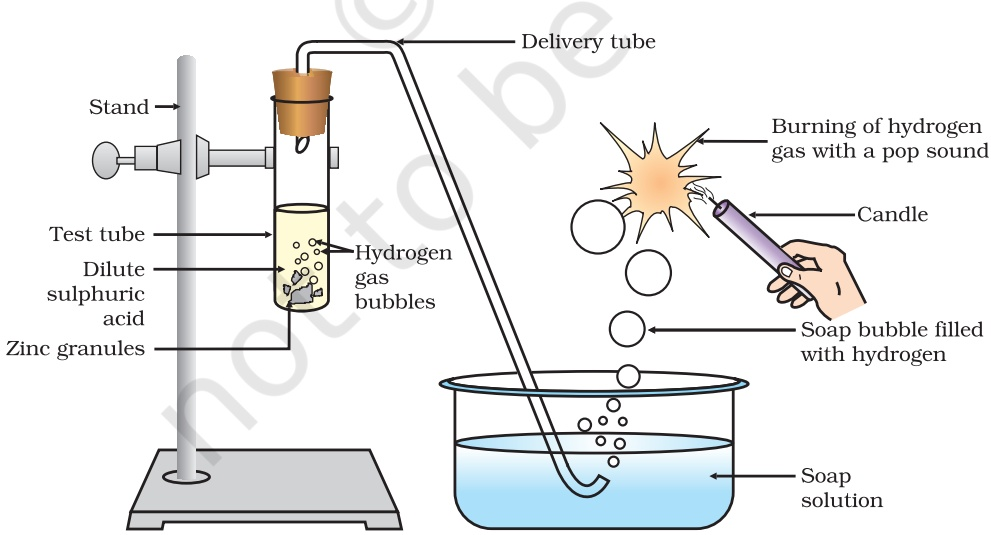

n **Rinse both cloth strips with water and again check their odour.**

n **Note your observations.**

**Now take some dilute vanilla essence and clove oil and check their odour.**

**Take some dilute HCl solution in one test tube and dilute NaOH solution in another. Add a few drops of dilute vanilla essence to both test tubes and shake well. Check the odour once again and record changes in odour, if any.**

**Similarly, test the change in the odour of clove oil with dilute HCl and dilute NaOH solutions and record your observations.**

**Which of these – vanilla, onion and clove, can be used as olfactory indicators on the basis of your observations?**

**Let us do some more activities to understand the chemical properties of acids and bases.**

## 2.1.2 How do Acids and Bases React with Metals?

## Activity 2.3

**CAUTION: This activity needs the teacher’s assistance.**

n **Set the apparatus as shown in Fig. 2.1.**

**Take about 5 mL of dilute sulphuric acid in a test tube and add a few pieces of zinc granules to it.**

n **What do you observe on the surface of zinc granules?**

n **Pass the gas being evolved through the soap solution.**

n **Why are bubbles formed in the soap solution?**

n **Take a burning candle near a gas filled bubble.**

n **What do you observe?**

Repeat this Activity with some more acids like HCl, HNO **and** CH COOH.

n **Are the observations in all the cases the same or different?**

Figure 2.1 Reaction of zinc granules with dilute sulphuric acid and testing hydrogen gas by burning