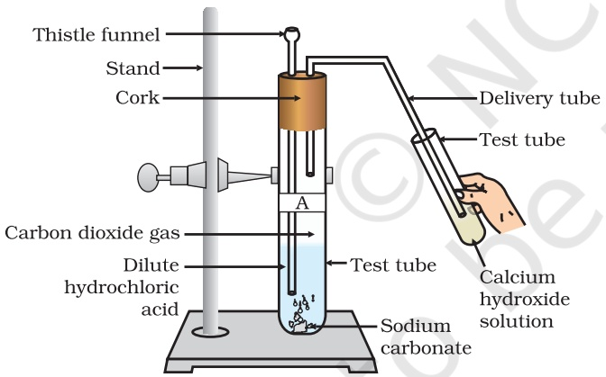

**Note that the metal in the above reactions displaces hydrogen atoms from the acids as hydrogen gas and forms a compound called a salt. Thus, the reaction of a metal with an acid can be summarised as –**

**Acid + Metal → Salt + Hydrogen gas**

**Can you now write the equations for the reactions you have observed?**

## Activity 2.4

n **Place a few pieces of granulated zinc metal in a test tube.**

**Add 2 mL of sodium hydroxide solution and warm the contents of the test tube.**

**Repeat the rest of the steps as in Activity 2.3 and record your observations.**

**The reaction that takes place can be written as follows.**

$$
\begin{aligned} 2NaOH(aq)  +  Zn(s)  \rightarrow  Na _2 ZnO _2 (s)  +  H _2 (g)  \\ (SOdim zincate) \end{aligned}
$$

**You find again that hydrogen is formed in the reaction. However, such reactions are not possible with all metals.**

## 2.1.3 How do Metal Carbonates and Metal Hydrogencarbonates React with Acids?

Figure 2.2

Passing carbon dioxide gas through calcium hydroxide solution

## Activity 2.5

**Take two test tubes, label them as A and B.**

**Take about 0.5 g of sodium carbonate** $\mathrm{(Na_{2}CO_{3})}$ **in test tube A and about** $0 . 5 ~ \mathrm { g }$ **of sodium hydrogencarbonate** $( \mathrm { N a H C O } _ { 3 } )$ **in test tube B.**

**Add about 2 mL of dilute HCl to both the test tubes.**

n **What do you observe?**

**Pass the gas produced in each case through lime water (calcium hydroxide solution) as shown in Fig. 2.2 and record your observations.**

**The reactions occurring in the above Activity are written as –**

Test tube A: $\mathrm{Na_{2}CO_{3}(s)+2HCl(aq)\rightarrow 2NaCl(aq)+H_{2}O(l)+CO_{2}(}$ **(g)**

Test tube B: $\mathrm{NaHCO_{3}(s)+HCl(aq)\rightarrow NaCl(aq)+H_{2}O(l)+CO_{2}(g)}$

**On passing the carbon dioxide gas evolved through lime water,**

$$
\begin{aligned} & Ca(OH) _2 (aq)  +  CO _2 (g)  \rightarrow  CaCO _3 (s)  +  H _2 O(l) \\ &\begin{aligned} (Line water)  \quad & (white reweighted)  \end{aligned}\\ \end{aligned}
$$