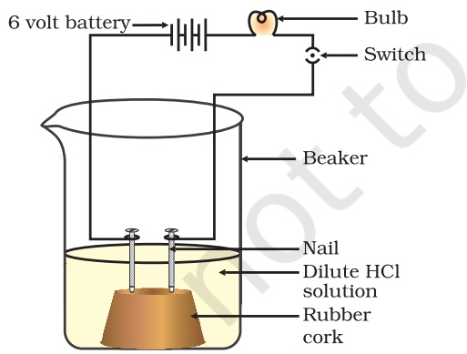

**Now write and balance the equation for the above reaction. Since metallic oxides react with acids to give salts and water, similar to the reaction of a base with an acid, metallic oxides are said to be basic oxides.**

## 2.1.6 Reaction of a Non-metallic Oxide with Base

**You saw the reaction between carbon dioxide and calcium hydroxide (lime water) in Activity 2.5. Calcium hydroxide, which is a base, reacts with carbon dioxide to produce a salt and water. Since this is similar to the reaction between a base and an acid, we can conclude that non-metallic oxides are acidic in nature.**

## Q U E S T I O N S

**1. Why should curd and sour substances not be kept in brass and copper vessels?**

**2. Which gas is usually liberated when an acid reacts with a metal? Illustrate with an example. How will you test for the presence of this gas?**

**3. Metal compound A reacts with dilute hydrochloric acid to produce effervescence. The gas evolved extinguishes a burning candle. Write a balanced chemical equation for the reaction if one of the compounds formed is calcium chloride.**

## 2.2 WHAT DO ALL ACIDS AND ALL BASES HAVE IN COMMON?

**In Section 2.1 we have seen that all acids have similar chemical properties. What leads to this similarity in properties? We saw in Activity 2.3 that all acids generate hydrogen gas on reacting with metals, so hydrogen seems to be common to all acids. Let us perform an Activity to investigate whether all compounds containing hydrogen are acidic.**

Figure 2.3

Acid solution in water

conducts electricity

## Activity 2.8

**Take solutions of glucose, alcohol, hydrochloric acid, sulphuric acid, etc.**

**Fix two nails on a cork, and place the cork in a 100 mL beaker.**

**Connect the nails to the two terminals of a 6 volt battery through a bulb and a switch, as shown in Fig. 2.3.**

**Now pour some dilute HCl in the beaker and switch on the current.**

n **Repeat with dilute sulphuric acid.**

n **What do you observe?**

**Repeat the experiment separately with glucose and alcohol solutions. What do you observe now?**

n **Does the bulb glow in all cases?**