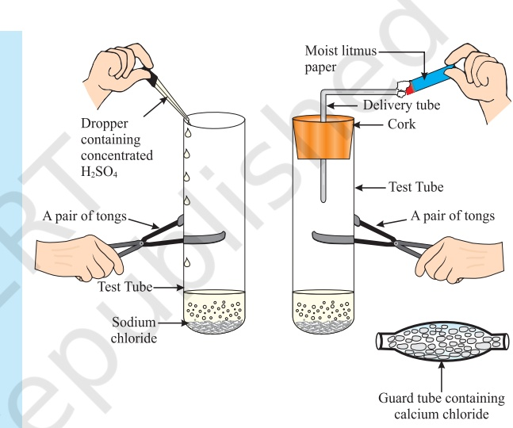

**The bulb will start glowing in the case of acids, as shown in Fig. 2.3. But you will observe that glucose and alcohol solutions do not conduct electricity. Glowing of the bulb indicates that there is a flow of electric current through the solution. The electric current is carried through the acidic solution by ions.**

**Acids contain H+ ion as cation and anion such as Cl– in** HCl, $\mathrm { N O _ { 3 } ^ { - } }$ **in** $\mathrm { H N O } _ { 3 } , \mathrm { S O } _ { 4 } ^ { 2 - }$ in $\mathrm{H_{2}SO_{4},CH_{3}COO}$ in $\mathrm{CH_{3}COOH}$ . Since the cation present in acids is $\mathrm { H } ^ { \dot { + } }$ **, this suggests that acids produce hydrogen ions, H+(aq), in solution, which are responsible for their acidic properties.**

**Repeat the same Activity using alkalis such as sodium hydroxide, calcium hydroxide, etc. What can you conclude from the results of this Activity?**

## 2.2.1 What Happens to an Acid or a Base in a Water Solution?

**Do acids produce ions only in aqueous solution? Let us test this.**

## Activity 2.9

**Take about 1g solid NaCl in a clean and dry test tube and set up the apparatus as shown in Fig. 2.4.**

**Add some concentrated sulphuric acid to the test tube.**

**What do you observe? Is there a gas coming out of the delivery tube?**

**Test the gas evolved successively with dry and wet blue litmus paper.**

**In which case does the litmus paper change colour?**

**On the basis of the above Activity, what do you infer about the acidic character of: (i) dry HCl gas**

Figure 2.4 Preparation of HCl gas

**(ii) HCl solution?**

**Note to teachers: If the climate is very humid, you will have to pass the gas produced through a guard tube (drying tube) containing calcium chloride to dry the gas.**

**This experiment suggests that hydrogen ions in HCl are produced** in the presence of water. The separation of $\mathrm { H ^ { + } }$ **ion from HCl molecules cannot occur in the absence of water.**

$$
\mathrm{HCl}+\mathrm{H}_{2}\mathrm{O}\rightarrow\mathrm{H}_{3}\mathrm{O}^{+}+\mathrm{Cl}^{-}
$$

**Hydrogen ions cannot exist alone, but they exist after combining with water molecules. Thus hydrogen ions must always be shown as** H+(aq) or hydronium ion $\mathrm { ( H _ { 3 } O ^ { + } ) }$

$$
\mathrm{H^{+}+H_{2}O\rightarrow H_{3}O^{+}}
$$

We have seen that acids give $\mathrm { H _ { 3 } O ^ { + } }$ **or H+(aq) ion in water. Let us see what happens when a base is dissolved in water.**

$$
\mathrm{NaOH(s)} \xrightarrow{\mathrm{H_2O}} \mathrm{Na^+(aq)} + \mathrm{OH^-(aq)}
$$