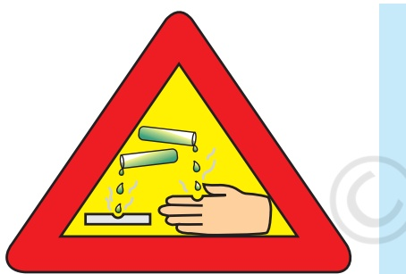

$$
\mathrm{KOH(s) \xrightarrow{H_2O} K^+(aq) + OH^-(aq)}
$$

$$
\mathrm{Mg(OH)_2(s)_{\xrightarrow{H_2O}Mg^{2+}(aq)+2OH^{-}(aq)}}
$$

**Bases generate hydroxide (OH–) ions in water. Bases which are soluble in water are called alkalis.**

## 0 d

**All bases do not dissolve in water. An alkali is a base that dissolves in water. They are soapy to touch, bitter and corrosive. Never taste or touch them as they may cause harm. Which of the bases in the Table 2.1 are alkalis?**

**Now as we have identified that all acids generate H+(aq) and all** bases generate OH **(aq), we can view the neutralisation reaction as follows –**

$$
\mathrm { A c i d } + \mathrm { B a s e } \rightarrow \mathrm { S a l t } + \mathrm { W a t e r }
$$

$$
\mathrm{H}\left[\mathrm{X}+\mathrm{M}\right]\mathrm{OH}\rightarrow\mathrm{MX}+\mathrm{HOH}
$$

$$
\mathrm{H^{+}(aq) + OH^{-}(aq) \rightarrow H_{2}O(l)}
$$

**Let us see what is involved when water is mixed with an acid or a base.**

Figure 2.5 Warning sign displayed on containers containing concentrated acids and bases

## Activity 2.10

**Take 10 mL water in a beaker.**

Add a few drops of concentrated $\mathrm{H_{2}SO_{4}}$ **to it and swirl the beaker slowly.**

**Touch the base of the beaker.**

**Is there a change in temperature?**

n **Is this an exothermic or endothermic process?**

**Repeat the above Activity with sodium hydroxide pellets and record your observations.**

**The process of dissolving an acid or a base in water is a highly exothermic one. Care must be taken while mixing concentrated nitric acid or sulphuric acid with water. The acid must always be added slowly to water with constant stirring. If water is added to a concentrated acid, the heat generated may cause the mixture to splash out and cause burns. The glass container may also break due to excessive local heating. Look out for the warning sign (shown in Fig. 2.5) on the can of concentrated sulphuric acid and on the bottle of sodium hydroxide pellets.**

**Mixing an acid or base with water results in decrease in the** concentration of ions $\mathrm { ( H _ { 3 } O ^ { + } / O H ^ { - } ) }$ **per unit volume. Such a process is called dilution and the acid or the base is said to be diluted.**