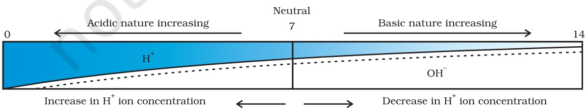

## Q U E S T I O N S

1 Why do HCl, HNO **, etc., show acidic characters in aqueous solutions while solutions of compounds like alcohol and glucose do not show acidic character?**

**2. Why does an aqueous solution of an acid conduct electricity?**

**3. Why does dry HCl gas not change the colour of the dry litmus paper?**

**4. While diluting an acid, why is it recommended that the acid should be added to water and not water to the acid?**

**5.** How is the concentration of hydronium ions $\mathrm { ( H _ { 3 } O ^ { + } ) }$ **a**ffected when a **solution of an acid is diluted?**

**6. How is the concentration of hydroxide ions (OH–) affected when excess base is dissolved in a solution of sodium hydroxide?**

## 2.3 HOW STRONG ARE ACID OR BASE SOLUTIONS?

**We know how acid-base indicators can be used to distinguish between an acid and a base. We have also learnt in the previous section about dilution and decrease in concentration of H+ or OH– ions in solutions. Can we quantitatively find the amount of these ions present in a solution? Can we judge how strong a given acid or base is?**

**We can do this by making use of a universal indicator, which is a mixture of several indicators. The universal indicator shows different colours at different concentrations of hydrogen ions in a solution.**

**A scale for measuring hydrogen ion concentration in a solution, called pH scale has been developed. The p in pH stands for ‘potenz’ in German, meaning power. On the pH scale we can measure pH generally from 0 (very acidic) to 14 (very alkaline). pH should be thought of simply as a number which indicates the acidic or basic nature of a solution. Higher the hydronium ion concentration, lower is the pH value.**

**The pH of a neutral solution is 7. Values less than 7 on the pH scale represent an acidic solution. As the pH value increases from 7 to 14, it represents an increase in OH– ion concentration in the solution, that is, increase in the strength of alkali (Fig. 2.6). Generally paper impregnated with the universal indicator is used for measuring pH.**

Figure 2.6 Variation of pH with the change in concentration of H+(aq) and OH–(aq) ions