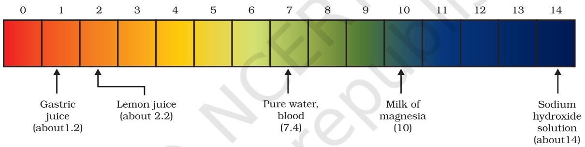

## Activity 2.11

**Test the pH values of solutions given in Table 2.2.**

n **Record your observations.**

**What is the nature of each substance on the basis of your observations?**

Table 2.2

| S.No | Solution | Colour ofpH paper | Approx--imatepH value | Nature ofsubstance |
| --- | --- | --- | --- | --- |
| 1 | Saliva (before meal) |  |  |  |
| 2 | Saliva (after meal) |  |  |  |
| 3 | Lemon juice |  |  |  |
| 4 | Colourless aerateddrink |  |  |  |
| 5 | Carrot juice |  |  |  |
| 6 | Coffee |  |  |  |
| 7 | Tomato juice |  |  |  |
| 8 | Tap water |  |  |  |
| 9 | 1M NaOH |  |  |  |
| 10 | 1M HCl |  |  |  |

Figure 2.7 pH of some common substances shown on a pH paper (colours are only a rough guide)

**The strength of acids and bases depends on the number of H+ ions and OH– ions produced, respectively. If we take hydrochloric acid and acetic acid of the same concentration, say one molar, then these produce different amounts of hydrogen ions. Acids that give rise to more H+ ions are said to be strong acids, and acids that give less H+ ions are said to be weak acids. Can you now say what weak and strong bases are?**

## 2.3.1 Importance of pH in Everyday Life

## Are plants and animals pH sensitive?

**Our body works within the pH range of 7.0 to 7.8. Living organisms can survive only in a narrow range of pH change. When pH of rain water is less than 5.6, it is called acid rain. When acid rain flows into the rivers, it lowers the pH of the river water. The survival of aquatic life in such rivers becomes difficult.**