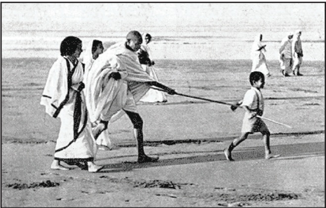

**Identify the acids and bases from which the above salts may be obtained.**

**Salts having the same positive or negative radicals are said to** belong to a family. For example, NaCl and $\mathrm{Na_{2}SO_{4}}$ **belong to the family of sodium salts. Similarly, NaCl and KCl belong to the family of chloride salts. How many families can you identify among the salts given in this Activity?**

## 2.4.2 pH of Salts

## Activity 2.14

**Collect the following salt samples – sodium chloride, potassium nitrate, aluminium chloride, zinc sulphate, copper sulphate, sodium acetate, sodium carbonate and sodium hydrogencarbonate (some other salts available can also be taken).**

n **Check their solubility in water (use distilled water only).**

**Check the action of these solutions on litmus and find the pH using a pH paper.**

n **Which of the salts are acidic, basic or neutral?**

n **Identify the acid or base used to form the salt.**

n **Report your observations in Table 2.4.**

**Salts of a strong acid and a strong base are neutral with pH value of 7. On the other hand, salts of a strong acid and weak base are acidic with pH value less than 7 and those of a strong base and weak acid are basic in nature, with pH value more than 7.**

Table 2.4

| Salt | pH | Acid used | Base used |
| --- | --- | --- | --- |
|  |  |  |  |

## 2.4.3 Chemicals from Common Salt

**By now you have learnt that the salt formed by the combination of hydrochloric acid and sodium hydroxide solution is called sodium chloride. This is the salt that you use in food. You must have observed in the above Activity that it is a neutral salt.**

**Seawater contains many salts dissolved in it. Sodium chloride is separated from these salts. Deposits of solid salt are also found in several parts of the world. These large crystals are often brown due to impurities. This is called rock salt. Beds of rock salt were formed when seas of bygone ages dried up. Rock salt is mined like coal.**

**You must have heard about Mahatma Gandhi’s Dandi March. Did you know that sodium chloride was such an important symbol in our struggle for freedom?**