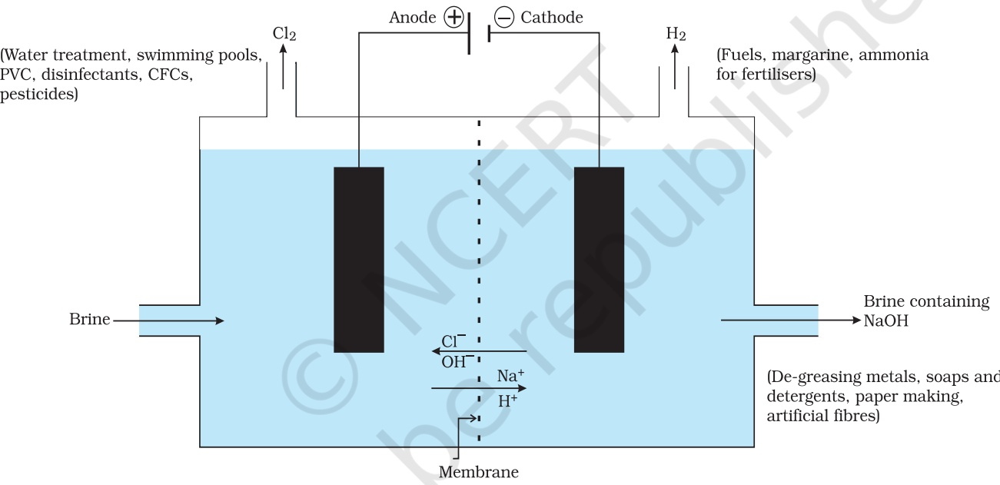

## Common salt — A raw material for chemicals

**The common salt thus obtained is an important raw material for various materials of daily use, such as sodium hydroxide, baking soda, washing soda, bleaching powder and many more. Let us see how one substance is used for making all these different substances.**

## Sodium hydroxide

**When electricity is passed through an aqueous solution of sodium chloride (called brine), it decomposes to form sodium hydroxide. The process is called the chlor-alkali process because of the products formed– chlor for chlorine and alkali for sodium hydroxide.**

$$
\mathrm{2NaCl(aq)+2H_{2}O(l)\rightarrow 2NaOH(aq)+Cl_{2}(g)+H_{2}(g)}
$$

**Chlorine gas is given off at the anode, and hydrogen gas at the cathode. Sodium hydroxide solution is formed near the cathode. The three products produced in this process are all useful. Figure 2.8 shows the different uses of these products.**

Important products from the chlor-alkali process

## Bleaching powder

**You have already come to know that chlorine is produced during the electrolysis of aqueous sodium chloride (brine). This chlorine gas is used for the manufacture of bleaching powder. Bleaching powder is produced** by the action of chlorine on dry slaked lime $\mathrm { [ C a ( O H ) _ { 2 } ] }$ **. Bleaching powder** is represented as $\mathrm{Ca(ClO)_{_2}}$ **, though the actual composition is quite complex.**

$$
2\mathrm{Ca(OH)_2+2Cl_2\rightarrow Ca(ClO)_2+CaCl_2+2H_2O}
$$