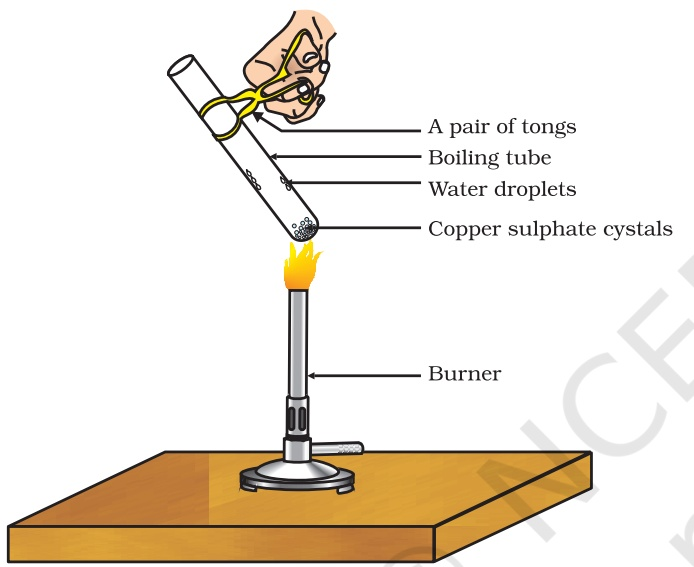

What does $1 0 \mathrm { H } _ { 2 } \mathrm { O }$ signify? Does it make $\mathrm { N a _ { 2 } C O _ { 3 } }$ **wet? We will address this question in the next section.**

**Sodium carbonate and sodium hydrogencarbonate are useful chemicals for many industrial processes as well.**

## Uses of washing soda

**(i) Sodium carbonate (washing soda) is used in glass, soap and paper industries.**

**(ii) It is used in the manufacture of sodium compounds such as borax.**

**(iii) Sodium carbonate can be used as a cleaning agent for domestic purposes.**

**(iv) It is used for removing permanent hardness of water.**

## 2.4.4 Are the Crystals of Salts really Dry?

Figure 2.9 Removing water of crystallisation

## Activity 2.15

**Heat a few crystals of copper sulphate in a dry boiling tube.**

**What is the colour of the copper sulphate after heating?**

**Do you notice water droplets in the boiling tube? Where have these come from?**

**Add 2-3 drops of water on the sample of copper sulphate obtained after heating.**

**What do you observe? Is the blue colour of copper sulphate restored?**

**Copper sulphate crystals which seem to be dry contain water of crystallisation. When we heat the crystals, this water is removed and the salt turns white.**

**If you moisten the crystals again with water, you will find that blue colour of the crystals reappears.**

**Water of crystallisation is the fixed number of water molecules present in one formula unit of a salt. Five water molecules are present in one formula unit of copper sulphate. Chemical formula for hydrated copper** sulphate is Cu $\mathrm{SO}_{4^{-}}^{-}\mathrm{^{5}H_{2}O}$ **. Now you would be able to answer the question** whether the molecule of $\mathrm{Na_{2}CO_{3}.10H_{2}O}$ **is wet.**

**One other salt, which possesses water of crystallisation is gypsum. It has two water molecules as water of cyrstallisation. It has the chemical** formula $CaSO _{4} .2 H _{2} O$ **.** Let us look into the use of this salt.

## Plaster of Paris

**On heating gypsum at 373 K, it loses water molecules and becomes**

calcium sulphate hemihydrate $( \mathrm { C a S O } _ { 4 }   . \frac { 1 } { 2 }   \mathrm { H } _ { 2 } \mathrm { O }   )$ **. This is called Plaster of**