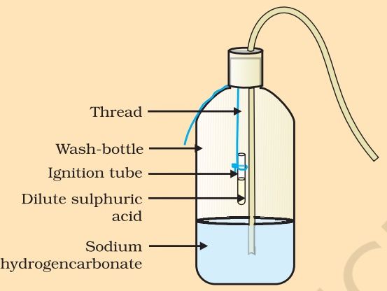
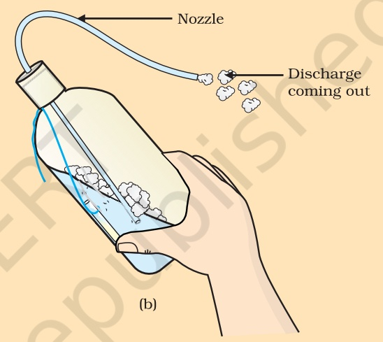

## (II) Preparing a soda-acid fire extinguisher

**The reaction of acids with metal hydrogencarbonates is used in the fire extinguishers which produce carbon dioxide.**

n Take 20 mL of sodium hydrogencarbonate $\mathrm{(NaHCO_{3})}$ **solution in a wash-bottle.**

Suspend an ignition tube containing dilute sulphuric acid in the wash-bottle **(Fig. 2.10).**

n **Close the mouth of the wash-bottle.**

Tilt the wash-bottle so that the acid from the ignition tube mixes with the sodium **hydrogencarbonate solution below.**

n **You will notice discharge coming out of the nozzle.**

Direct this discharge on a burning candle. What happens?

(a)

**Figure 2.10 (a) Ignition tube containing dilute sulphuric acid suspended in a wash-bottle containing sodium hydrogencarbonate, (b) Discharge coming out of the nozzle**