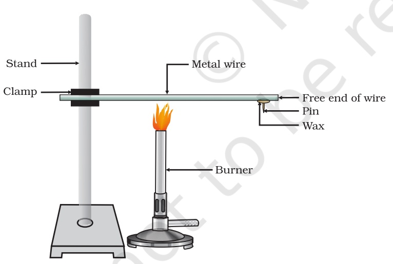

**You will find that metals are generally hard. The hardness varies from metal to metal.**

## Activity 3.3

n **Take pieces of iron, zinc, lead and copper.**

**Place any one metal on a block of iron and strike it four or five times with a hammer. What do you observe?**

n **Repeat with other metals.**

**Record the change in the shape of these metals.**

**You will find that some metals can be beaten into thin sheets. This property is called malleability. Did you know that gold and silver are the most malleable metals?**

## Activity 3.4

**List the metals whose wires you have seen in daily life.**

**The ability of metals to be drawn into thin wires is called ductility. Gold is the most ductile metal. You will be surprised to know that a wire of about 2 km length can be drawn from one gram of gold.**

**It is because of their malleability and ductility that metals can be given different shapes according to our needs.**

**Can you name some metals that are used for making cooking vessels? Do you know why these metals are used for making vessels? Let us do the following Activity to find out the answer.**

Figure 3.1 Metals are good conductors of heat.

## Activity 3.5

**Take an aluminium or copper wire. Clamp this wire on a stand, as shown in Fig. 3.1.**

**Fix a pin to the free end of the wire using wax.**

**Heat the wire with a spirit lamp, candle or a burner near the place where it is clamped.**

**What do you observe after some time?**

**Note your observations. Does the metal wire melt?**

**The above activity shows that metals are good conductors of heat and have high melting points. The best conductors of heat are silver and copper. Lead and mercury are comparatively poor conductors of heat.**

**Do metals also conduct electricity? Let us find out.**