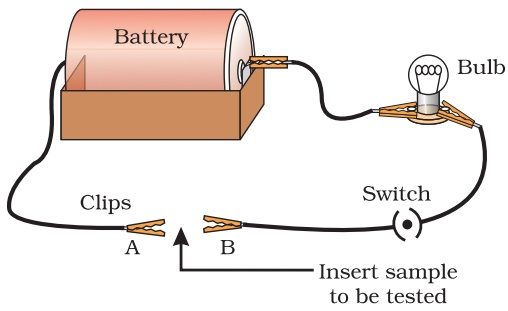

## Activity 3.6

n **Set up an electric circuit as shown in Fig. 3.2.**

**Place the metal to be tested in the circuit between terminals A and B as shown.**

**Does the bulb glow? What does this indicate?**

**You must have seen that the wires that carry current in your homes have a coating of polyvinylchloride (PVC) or a rubber-like material. Why are electric wires coated with such substances?**

Figure 3.2 Metals are good conductors of electricity.

**What happens when metals strike a hard surface? Do they produce a sound? The metals that produce a sound on striking a hard surface are said to be sonorous. Can you now say why school bells are made of metals?**

## 3.1.2 Non-metals

**In the previous Class you have learnt that there are very few non-metals as compared to metals. Some of the examples of non-metals are carbon, sulphur, iodine, oxygen, hydrogen, etc. The non-metals are either solids or gases except bromine which is a liquid.**

**Do non-metals also have physical properties similar to that of metals? Let us find out.**

## Activity 3.7

n **Collect samples of carbon (coal or graphite), sulphur and iodine.**

**Carry out the Activities 3.1 to 3.4 and 3.6 with these non-metals and record your observations.**

**Compile your observations regarding metals and non-metals in Table 3.1.**

Table 3.1

| Element | Symbol | Type ofsurface | Hardness | Malleability | Ductility | ConductsElectricity | Sonority |
| --- | --- | --- | --- | --- | --- | --- | --- |
|  |  |  |  |  |  |  |  |

**On the bases of the observations recorded in Table 3.1, discuss the general physical properties of metals and non-metals in the class. You must have concluded that we cannot group elements according to their physical properties alone, as there are many exceptions. For example –**

**(i) All metals except mercury exist as solids at room temperature. In Activity 3.5, you have observed that metals have high melting**