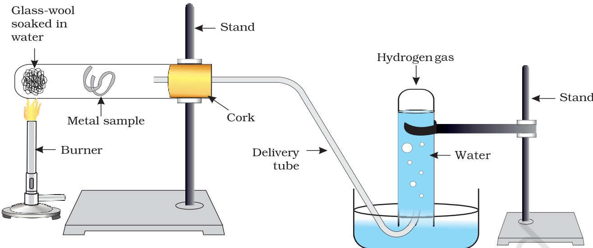

Figure 3.3 Action of steam on a metal

**Metals react with water and produce a metal oxide and hydrogen gas. Metal oxides that are soluble in water dissolve in it to further form metal hydroxide. But all metals do not react with water.**

**Metal + Water → Metal oxide + Hydrogen Metal oxide + Water → Metal hydroxide**

**Metals like potassium and sodium react violently with cold water. In case of sodium and potassium, the reaction is so violent and exothermic that the evolved hydrogen immediately catches fire.**

$$
\begin{array}{l}\text { 2K(s) }+ \text { 2H }_{2} \text {O(l) } \rightarrow \text { 2KOH(aq) }+ \text { H }_{2} 图+ \text { heat energy } \\\text { 2Na(s) }+ \text { 2H }_{2} \text {O(l) } \rightarrow \text { 2NaOH(aq) }+ \text { H }_{2} \text {(g) }+ \text { heat }_{2} \text {''BFF }\end{array}
$$

**The reaction of calcium with water is less violent. The heat evolved is not sufficient for the hydrogen to catch fire.**

$$
\mathrm{Ca(s)+2H_{2}O(l)\rightarrow Ca(OH)_{2}(aq)+H_{2}(g)}
$$

**Calcium starts floating because the bubbles of hydrogen gas formed stick to the surface of the metal.**

**Magnesium does not react with cold water. It reacts with hot water to form magnesium hydroxide and hydrogen. It also starts floating due to the bubbles of hydrogen gas sticking to its surface.**

**Metals like aluminium, iron and zinc do not react either with cold or hot water. But they react with steam to form the metal oxide and hydrogen.**

$$
\begin{array}{l} 2Al(s)   +   3 H _2 O(g)  \rightarrow   Al _2 O _3 (s)  +  3 H _2 (g)  \\ 3Fe(s)   +   4 H _2 O(g)  \rightarrow   Fe _3 O _4 (s)  +  4 H _2 (g) \end{array}
$$

**Metals such as lead, copper, silver and gold do not react with water at all.**

## 3.2.3 What happens when Metals react with Acids?

**You have already learnt that metals react with acids to give a salt and hydrogen gas.**