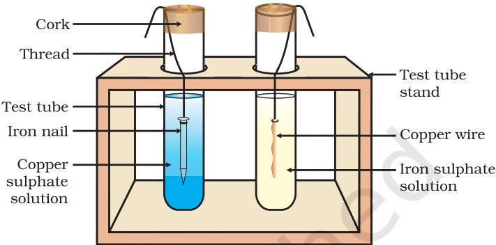

n **In which test tube did you find that a reaction has occurred?**

**On what basis can you say that a reaction has actually taken place?**

**Can you correlate your observations for the Activities 3.9, 3.10 and 3.11?**

**Write a balanced chemical equation for the reaction that has taken place.**

n **Name the type of reaction.**

**Reactive metals can displace less reactive metals from their compounds in solution or molten form.**

**We have seen in the previous sections that all metals are not equally reactive. We checked the reactivity of various metals with oxygen, water and acids. But all metals do not react with these reagents. So we were not able to put all the metal samples we had collected in decreasing order of their reactivity. Displacement reactions studied in Chapter 1 give better evidence about the reactivity of metals. It is simple and easy if metal A displaces** **metal B from its solution, it is more reactive than B.**

Figure 3.4 Reaction of metals with salt solutions

**Metal A + Salt solution of B → Salt solution of A + Metal B**

**Which metal, copper or iron, is more reactive according to your observations in Activity 3.12?**

## 3.2.5 The Reactivity Series

**The reactivity series is a list of metals arranged in the order of their decreasing activities. After performing displacement experiments (Activities 1.9 and 3.12), the following series, (Table 3.2) known as the reactivity or activity series has been developed.**

Table 3.2 Activity series : Relative reactivities of metals

| K Potassium Na Sodium Ca Calcium Mg Magnesium Al Aluminium Zn Zinc Fe Iron Pb Lead [H] [Hydrogen] Cu Copper Hg Mercury Ag Silver Au Gold | Most reactive Reactivity decreases Least reactive |
| --- | --- |