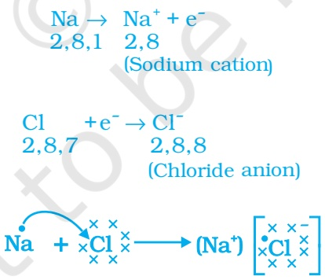

Table 3.3 Electronic configurations of some elements

<table><tr><td>Type ofelement</td><td>Element</td><td>Atomicnumber</td><td>Number ofelectrons in shellsK     L   M      N</td></tr><tr><td>Noble gases</td><td>Helium (He)Neon (Ne)Argon (Ar)</td><td>21018</td><td>22     82     8    8</td></tr><tr><td rowspan=4>Metals</td><td rowspan=4>Sodium (Na)Magnesium (Mg)Aluminium (Al)Potassium (K)Calcium (Ca)</td><td rowspan=2>1112</td><td rowspan=2>2     8    1</td></tr><tr><td rowspan=2>2     8    3</td></tr><tr><td>13</td></tr><tr><td>1920</td><td>2     8    8        12     8    8       2</td></tr><tr><td rowspan=4>Non-metals</td><td rowspan=4>Nitrogen (N)Oxygen (O)Fluorine (F)Phosphorus (P)Sulphur (S)Chlorine (Cl)</td><td>7</td><td>2     5</td></tr><tr><td>8915</td><td rowspan=3>2     622      8    52     8    62     8     7</td></tr><tr><td>16</td></tr><tr><td>17</td></tr></table>

and it requires one more electron to complete its octet. If sodium and chlorine were to react, the electron lost by sodium could be taken up by chlorine. After gaining an electron, the chlorine atom gets a unit negative charge, because its nucleus has 17 protons and there are 18 electrons in its K, L and M shells. This gives us a chloride anion C1–. So both these elements can have a give-and-take relation between them as follows (Fig. 3.5).

Figure 3.5 Formation of sodium chloride

**Sodium and chloride ions, being oppositely charged, attract each other and are held by strong electrostatic forces of attraction to exist as sodium chloride (NaCl). It should be noted that sodium chloride does not exist as molecules but aggregates of oppositely charged ions.**

**Let us see the formation of one more ionic compound, magnesium chloride (Fig. 3.6).**