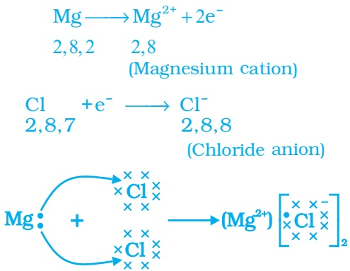
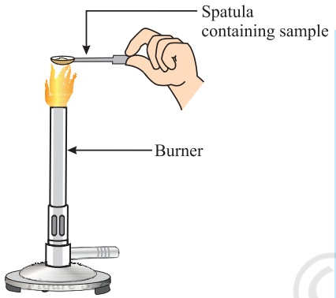
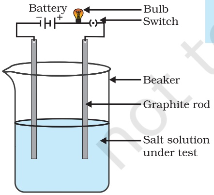

Heating a salt sample on a spatula

Figure 3.6 Formation of magnesium chloride

**The compounds formed in this manner by the transfer of electrons from a metal to a non-metal are known as ionic compounds or electrovalent compounds. Can you name the cation and anion present** in $\mathrm { M g C l } _ { 2 } ?$

## 3.3.1 Properties of Ionic Compounds

**To learn about the properties of ionic compounds, let us perform the following Activity:**

Figure 3.7

Figure 3.8

Testing the conductivity of a salt solution

## Activity 3.13

**Take samples of sodium chloride, potassium iodide, barium chloride or any other salt from the science laboratory.**

n **What is the physical state of these salts?**

**Take a small amount of a sample on a metal spatula and heat directly on the flame (Fig. 3.7). Repeat with other samples.**

**What did you observe? Did the samples impart any colour to the flame? Do these compounds melt?**

n **Try to dissolve the samples in water, petrol and kerosene. Are they soluble?**

**Make a circuit as shown in Fig. 3.8 and insert the electrodes into a solution of one salt. What did you observe? Test the other salt samples too in this manner.**

**What is your inference about the nature of these compounds?**

Table 3.4 Melting and boiling points of some ionic compounds

| Ionic | Melting point | Boiling point |
| --- | --- | --- |
| compound | (K) | (K) |
| NaCl | 1074 | 1686 |
| LiCl | 887 | 1600 |
| CaCl2 | 1045 | 1900 |
| CaO | 2850 | 3120 |
| MgCl2 | 981 | 1685 |