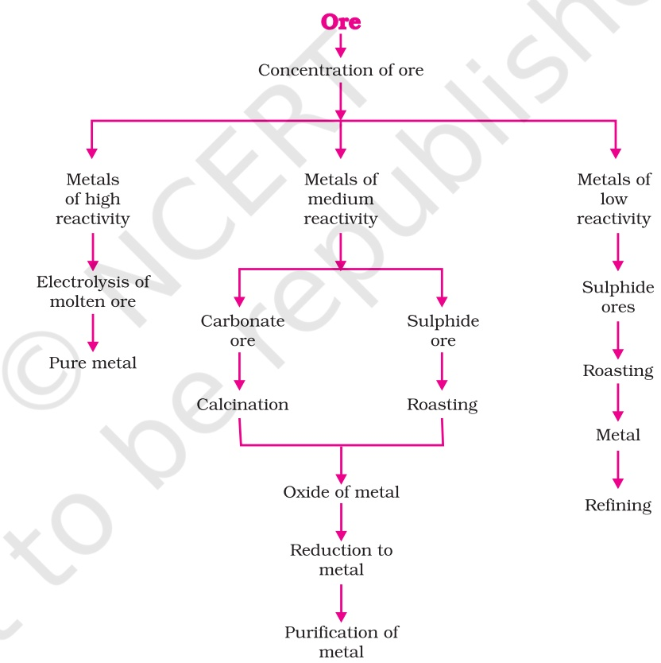

**state. For example, gold, silver, platinum and copper are found in the free state. Copper and silver are also found in the combined state as their sulphide or oxide ores. The metals at the top of the activity series (K, Na, Ca, Mg and Al) are so reactive that they are never found in nature as free elements. The metals in the middle of the activity series (Zn, Fe, Pb, etc.) are moderately reactive. They are found in the earth’s crust mainly as oxides, sulphides or carbonates. You will find that the ores of many metals are oxides. This is because oxygen is a very reactive element and is very abundant on the earth.**

**Thus on the basis of reactivity, we can group the metals into the following three categories (Fig. 3.9) – (i) Metals of low reactivity; (ii) Metals of medium reactivity; (iii) Metals of high reactivity. Different techniques are to be used for obtaining the metals falling in each category.**

**Several steps are involved in the extraction of pure metal from ores. A summary of these steps is given in Fig.3.10. Each step is explained in detail in the following sections.**

Figure 3.10 Steps involved in the extraction of metals from ores

## 3.4.2 Enrichment of Ores

**Ores mined from the earth are usually contaminated with large amounts of impurities such as soil, sand, etc., called gangue. The impurities must be removed from the ore prior to the extraction of the metal. The processes**