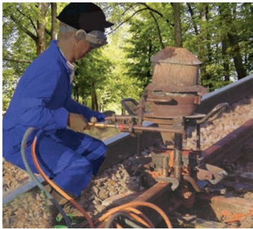
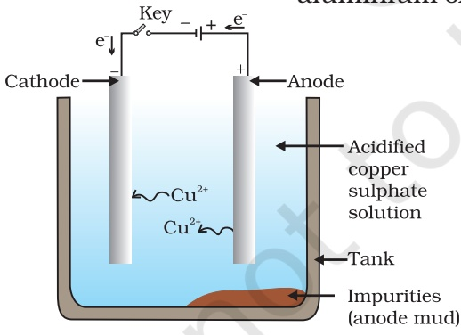

Figure 3.11 Thermit process for joining railway tracks

**agents because they can displace metals of lower reactivity from their compounds. For example, when manganese dioxide is heated with aluminium powder, the following reaction takes place –**

$$
3 MnO _2 (s) + 4 Al(s)  \rightarrow 3 Mn(l)  + 2 Al _2 O _3 (s) +  Heat
$$

**Can you identify the substances that are getting oxidised and reduced?**

**These displacement reactions are highly exothermic. The amount of heat evolved is so large that the metals are produced** in the molten state. In fact, the reaction of iron(III) oxide $( \mathrm { F e } _ { 2 } \mathrm { O } _ { 3 } )$ **with aluminium is used to join railway tracks or cracked machine parts. This reaction is known as the thermit reaction.**

$$
\mathrm{Fe_{2}O_{3}(s)+2Al(s)\rightarrow 2Fe(l)+Al_{2}O_{3}(s)+Heat}
$$

## 3.4.5 Extracting Metals towards the Top of the Activity Series

**The metals high up in the reactivity series are very reactive. They cannot be obtained from their compounds by heating with carbon. For example, carbon cannot reduce the oxides of sodium, magnesium, calcium, aluminium, etc., to the respective metals. This is because these metals have more affinity for oxygen than carbon. These metals are obtained by electrolytic reduction. For example, sodium, magnesium and calcium are obtained by the electrolysis of their molten chlorides. The metals are deposited at the cathode (the negatively charged electrode), whereas, chlorine is liberated at the anode (the positively charged electrode). The reactions are –**

$$
\begin{array}{l}\text { At cathode } \quad \text { Na }^{+}+\mathrm{e}^{-} \rightarrow \text { Na } \\\text { At ande } \quad \text { } \quad 2 \mathrm{Cl} \text { } \quad \rightarrow \text { Cl }_{2}+2 \mathrm{e}^{-}\end{array}
$$

**Similarly, aluminium is obtained by the electrolytic reduction of aluminium oxide.**

Figure 3.12

**Electrolytic refining of copper. The electrolyte is a solution of acidified copper sulphate. The anode is impure copper, whereas, the cathode is a strip of pure copper. On passing electric current, pure copper is deposited on the cathode.**

## 3.4.6 Refining of Metals

**The metals produced by various reduction processes described above are not very pure. They contain impurities, which must be removed to obtain pure metals. The most widely used method for refining impure metals is electrolytic refining.**

**Electrolytic Refining: Many metals, such as copper, zinc, tin, nickel, silver, gold, etc., are refined electrolytically. In this process, the impure metal is made the anode and a thin strip of pure metal is made the cathode. A solution of the metal salt is used as an electrolyte. The apparatus is set up as shown in Fig. 3.12. On passing the current through the electrolyte, the pure metal from the anode dissolves into the electrolyte. An equivalent amount of pure**