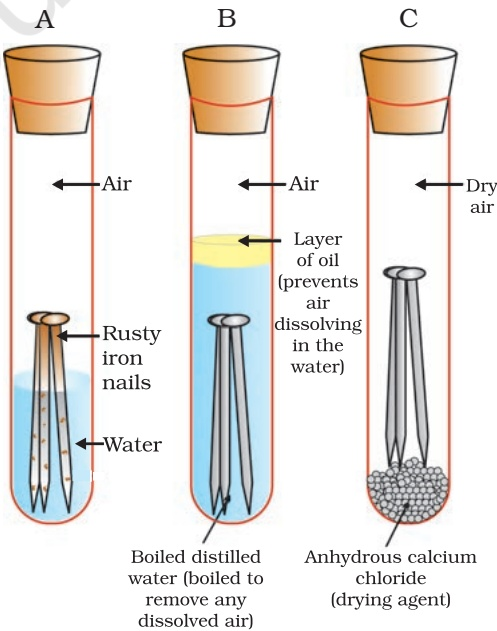

**metal from the electrolyte is deposited on the cathode. The soluble impurities go into the solution, whereas, the insoluble impurities settle down at the bottom of the anode and are known as anode mud.**

<table><tr><td>Q U E S T I O N S</td></tr><tr><td></td></tr><tr><td>Define the following terms. 1.</td></tr><tr><td>(ii) Ore (iii) Gangue (i) Mineral 2.  Name two metals which are found in nature in the free state.</td></tr></table>

## 3.5 CORROSION

**You have learnt the following about corrosion in Chapter 1 –**

**Silver articles become black after some time when exposed to air. This is because it reacts with sulphur in the air to form a coating of silver sulphide.**

**Copper reacts with moist carbon dioxide in the air and slowly loses its shiny brown surface and gains a green coat. This green substance is basic copper carbonate.**

**Iron when exposed to moist air for a long time acquires a coating of a brown flaky substance called rust.**

**Let us find out the conditions under which iron rusts.**

## Activity 3.14

**Take three test tubes and place clean iron nails in each of them.**

**Label these test tubes A, B and C. Pour some water in test tube A and cork it.**

**Pour boiled distilled water in test tube B, add about 1 mL of oil and cork it. The oil will float on water and prevent the air from dissolving in the water.**

**Put some anhydrous calcium chloride in test tube C and cork it. Anhydrous calcium chloride will absorb the moisture, if any, from the air. Leave these test tubes for a few days and then observe (Fig. 3.13).**

**You will observe that iron nails rust in test tube A, but they do not rust in test tubes B and C. In the test tube A, the nails are exposed to both air and water. In the test tube B, the nails are exposed to only water, and the nails in test tube C are exposed to dry air. What does this tell us about the conditions under which iron articles rust?**

Figure 3.13

**Investigating the conditions under which iron rusts. In tube A, both air and water are present. In tube B, there is no air dissolved in the water. In tube C, the air is dry.**