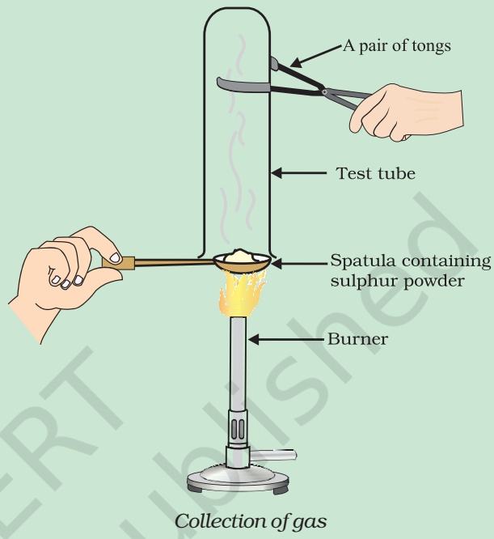

**8. In the electrolytic refining of a metal M, what would you take as the anode, the cathode and the electrolyte?**

**9. Pratyush took sulphur powder on a spatula and heated it. He collected the gas evolved by inverting a test tube over it, as shown in figure below.**

**(a) What will be the action of gas on**

**(i) dry litmus paper?**

**(ii) moist litmus paper?**

**(b) Write a balanced chemical equation for the reaction taking place.**

**10. State two ways to prevent the rusting of iron.**

**11. What type of oxides are formed when non-metals combine with oxygen?**

**12. Give reasons**

**(a) Platinum, gold and silver are used to make jewellery.**

**(b) Sodium, potassium and lithium are stored under oil.**

**(c) Aluminium is a highly reactive metal, yet it is used to make utensils for cooking.**

**(d) Carbonate and sulphide ores are usually converted into oxides during the process of extraction.**

**13. You must have seen tarnished copper vessels being cleaned with lemon or tamarind juice. Explain why these sour substances are effective in cleaning the vessels.**

**14. Differentiate between metal and non-metal on the basis of their chemical properties.**

**15. A man went door to door posing as a goldsmith. He promised to bring back the glitter of old and dull gold ornaments. An unsuspecting lady gave a set of gold bangles to him which he dipped in a particular solution. The bangles sparkled like new but their weight was reduced drastically. The lady was upset but after a futile argument the man beat a hasty retreat. Can you play the detective to find out the nature of the solution he had used?**

**16. Give reasons why copper is used to make hot water tanks and not steel (an alloy of iron).**