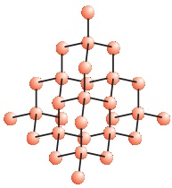
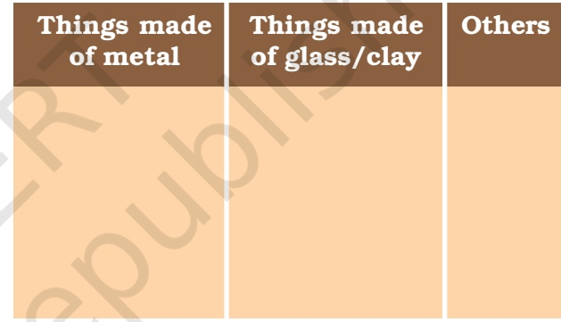

# CHAPTER4 Carbon and its Compounds

1064CH04

n the last Chapter, we came to know many compounds of importance I**to us. In this Chapter we will study about some more interesting compounds and their properties. Also, we shall be learning about carbon, an element which is of immense significance to us in both its elemental form and in the combined form.**

## Activity 4.1

**Make a list of ten things you have used or consumed since the morning.**

**Compile this list with the lists made by your classmates and then sort the items into the adjacent Table.**

**If there are items which are made up of more than one material, put them into both the relevant columns of the table.**

**Look at the items that come in the last column of the above table filled by you – your teacher will be able to tell you that most of them are made up of compounds of carbon. Can you think of a method to test this? What would be the product if a compound containing carbon is burnt? Do you know of any test to confirm this?**

**Food, clothes, medicines, books, or many of the things that you listed are all based on this versatile element carbon. In addition, all living structures are carbon based. The amount of carbon present in the earth’s crust and in the atmosphere is quite meagre. The earth’s crust has only 0.02% carbon in the form of minerals (like carbonates, hydrogencarbonates, coal and petroleum) and the atmosphere has 0.03% of carbon dioxide. In spite of this small amount of carbon available in nature, the importance of carbon seems to be immense. In this Chapter, we will know about the properties of carbon which make carbon so important to us.**

## 4.1 BONDING IN CARBON – THE COVALENT BOND

**In the previous Chapter, we have studied the properties of ionic compounds. We saw that ionic compounds have high melting and boiling points and conduct electricity in solution or in the molten state. We also**