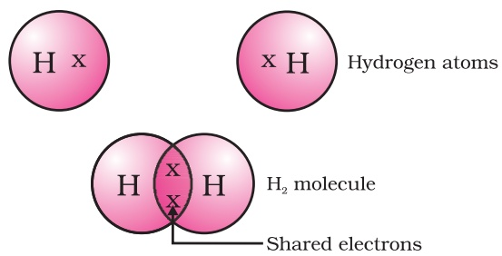
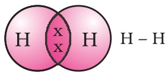
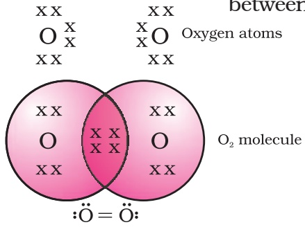
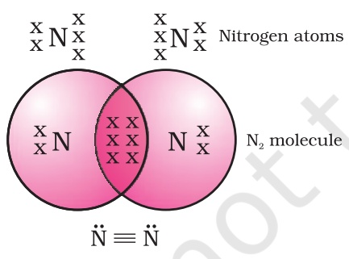

Shared electrons

H2 molecule

Figure 4.1 A molecule of hydrogen

**electronic configuration of the nearest noble gas, helium, which has two electrons in its K shell. We can depict this using dots or crosses to represent valence electrons (Fig. 4.1).**

**The shared pair of electrons is said to constitute a single covalent bond between the two hydrogen atoms. A single covalent bond is also represented by a line between the two atoms, as shown in Fig. 4.2.**

**The atomic number of chlorine is 17. What would be its electronic** configuration and its valency? Chlorine forms a diatomic molecule, Cl . **Can you draw the electron dot structure for this molecule? Note that only the valence shell electrons need to be depicted.**

Figure 4.2 Single bond between two hydrogen atoms

**In the case of oxygen, we see the formation of a double bond between two oxygen atoms. This is because an atom of oxygen has six electrons in its L shell (the atomic number of oxygen is eight) and it requires two more electrons to complete its octet. So each atom of oxygen shares two electrons with another atom of oxygen to give us the structure shown in Fig. 4.3. The two electrons contributed by each oxygen atom give rise to two shared pairs of electrons. This is said to constitute a double bond between the two atoms.**

Figure 4.3 Double bond between two oxygen atoms

**Can you now depict a molecule of water showing the nature of bonding between one oxygen atom and two hydrogen atoms? Does the molecule have single bonds or double bonds?**

**What would happen in the case of a diatomic molecule of nitrogen? Nitrogen has the atomic number 7. What would be its electronic configuration and its combining capacity? In order to attain an octet, each nitrogen atom in a molecule of nitrogen contributes three electrons giving rise to three shared pairs of electrons. This is said to constitute a triple bond** between the two atoms. The electron dot structure of $\left[ \mathbf { N } _ { 2 } \right.$ **and its triple bond can be depicted as in Fig. 4.4.**

Figure 4.4 Triple bond between two nitrogen atoms

A molecule of ammonia has the formula NH **. Can you draw the electron dot structure for this molecule showing how all four atoms achieve noble gas configuration? Will the molecule have single, double or triple bonds?**

**Let us now take a look at methane, which is a compound of carbon. Methane is widely used as a fuel and is a major component of bio-gas and Compressed Natural Gas (CNG). It is also one of the simplest compounds formed by carbon.** Methane has a formula CH **. Hydrogen, as you know, has a valency of 1. Carbon is tetravalent because it has four valence electrons. In order to achieve noble gas configuration, carbon shares these electrons with four atoms of hydrogen as shown in Fig. 4.5.**

**Such bonds which are formed by the sharing of an electron pair between two atoms are known as covalent bonds. Covalently bonded molecules are seen to have strong bonds within the molecule, but intermolecular forces are weak. This gives rise to the low melting and boiling**