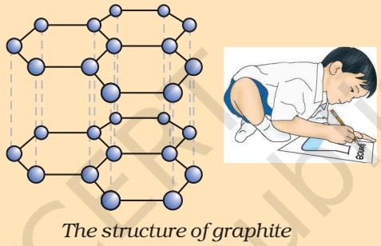
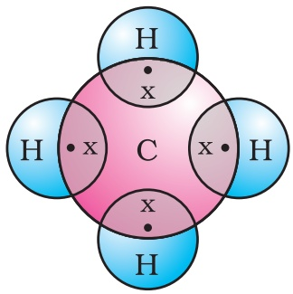
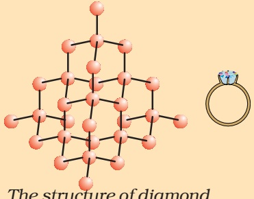
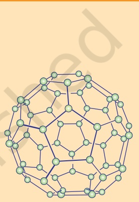

**points of these compounds. Since the electrons are shared between atoms and no charged particles are formed, such covalent compounds are generally poor conductors of electricity.**

## Allotropes of carbon

**The element carbon occurs in different forms in nature with widely varying physical properties. Both diamond and graphite are formed by carbon atoms, the difference lies in the manner in which the carbon atoms are bonded to one another. In diamond, each carbon atom is bonded to four other carbon atoms forming a rigid three-dimensional structure. In graphite, each carbon atom is bonded to three other carbon atoms in the same plane giving a hexagonal array. One of these bonds is a double-bond, and thus the valency of carbon is satisfied. Graphite structure is formed by the hexagonal arrays being placed in layers one above the other.**

Figure 4.5 Electron dot structure for methane

The structure of diamond

The structure of graphite

The structure of C-60 Buckminsterfullerene

**These two different structures result in diamond and graphite having very different physical properties even though their chemical properties are the same. Diamond is the hardest substance known while graphite is smooth and slippery. Graphite is also a very good conductor of electricity unlike other non-metals that you studied in the previous Chapter.**

**Diamonds can be synthesised by subjecting pure carbon to very high pressure and temperature. These synthetic diamonds are small but are otherwise indistinguishable from natural diamonds.**

**Fullerenes form another class of carbon allotropes. The first one to be identified was C-60 which has carbon atoms arranged in the shape of a football. Since this looked like the geodesic dome designed by the US architect Buckminster Fuller, the molecule was named fullerene.**

## Q U E S T I O N S

**1. What would be the electron dot structure of carbon dioxide which has** the formula CO ?

**2. What would be the electron dot structure of a molecule of sulphur which is made up of eight atoms of sulphur? (Hint – The eight atoms of sulphur are joined together in the form of a ring.)**

