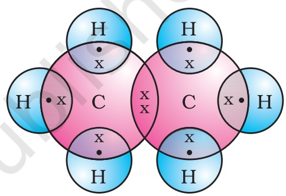
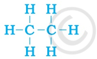
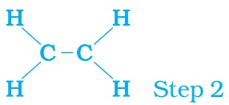
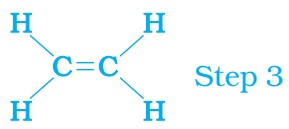

**Organic compounds**

**The two characteristic features seen in carbon, that is, tetravalency and catenation, put together give rise to a large number of compounds. Many have the same non-carbon atom or group of atoms attached to different carbon chains. These compounds were initially extracted from natural substances and it was thought that these carbon compounds or organic compounds could only be formed within a living system. That is, it was postulated that a ‘vital force’ was necessary for their synthesis. Friedrich Wöhler disproved this in 1828 by preparing urea from ammonium cyanate. But carbon compounds, except for carbides, oxides of carbon, carbonate and hydrogencarbonate salts continue to be studied under organic chemistry.**

## 4.2.1 Saturated and Unsaturated Carbon Compounds

**We have already seen the structure of methane. Another compound** formed between carbon and hydrogen is ethane with a formula of $\mathrm { C _ { 2 } H _ { 6 } } .$

**In order to arrive at the structure of simple carbon compounds, the first step is to link the carbon atoms together with a single bond (Fig. 4.6a) and then use the hydrogen atoms to satisfy the remaining valencies of carbon (Fig. 4.6b). For example, the structure of ethane is arrived in the following steps –**

$$
\mathbb { C } { \mathrm {  —  } } \mathbb { C }
$$

**Step 1**

**Figure 4.6 (a) Carbon atoms linked together with a single bond**

**Three valencies of each carbon atom remain unsatisfied, so each is bonded to three hydrogen atoms giving:**

**Step 2**

Figure 4.6 (c) Electron dot structure of ethane

**Figure 4.6 (b) Each carbon atom bonded to three hydrogen atoms**

**The electron dot structure of ethane is shown in Fig. 4.6(c).**

**Can you draw the structure of propane, which has the molecular formula** $\mathrm { C _ { 3 } H _ { 8 } }$ **in a similar manner? You will see that the valencies of all the atoms are satisfied by single bonds between them. Such carbon compounds are called saturated compounds. These compounds are normally not very reactive.**

**Step 1**

**However, another compound of carbon and hydrogen has the formula** $\mathrm { C _ { 2 } H _ { 4 } }$ **and is called ethene. How can this molecule be depicted? We follow the same step-wise approach as above.**

**Carbon-carbon atoms linked together with a single bond (Step 1).**

**We see that one valency per carbon atom remains unsatisfied (Step 2). This can be satisfied only if there is a double bond between the two carbons (Step 3).**

