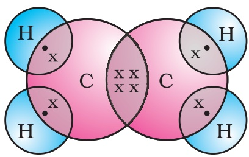

Figure 4.7 Structure of ethene

**The electron dot structure for ethene is given in Fig. 4.7. Yet another compound of hydrogen and carbon has the formula** $\mathrm { C _ { 2 } H _ { 2 } }$ **and is called ethyne. Can you draw the electron dot structure for ethyne? How many bonds are necessary between the two carbon atoms in order to satisfy their valencies? Such compounds of carbon having double or triple bonds between the carbon atoms are known as unsaturated carbon compounds and they are more reactive than the saturated carbon compounds.**

## 4.2.2 Chains, Branches and Rings

**In the earlier section, we mentioned the carbon compounds methane, ethane and propane, containing respectively 1, 2 and 3 carbon atoms. Such ‘chains’ of carbon atoms can contain many more carbon atoms. The names and structures of six of these are given in Table 4.2.**

Table 4.2 Formulae and structures of saturated compounds of carbon and hydrogen

<table><tbody><tr><td rowspan="2">No. of C atoms</td><td rowspan="2">Name</td><td rowspan="2">Formula Structure</td></tr><tr></tr><tr><td>1</td><td>Methane</td><td>CH4</td></tr><tr><td>2</td><td>Ethane</td><td>C2H6</td></tr><tr><td>3</td><td>Propane</td><td>C3H8</td></tr><tr><td>4</td><td>Butane</td><td>C4H10</td></tr><tr><td>5</td><td>Pentane</td><td>C5H12</td></tr><tr><td>6</td><td>Hexane</td><td>C6H14</td></tr></tbody></table>