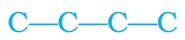
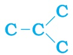
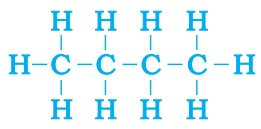
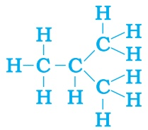
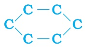
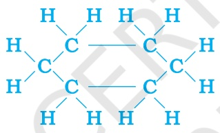
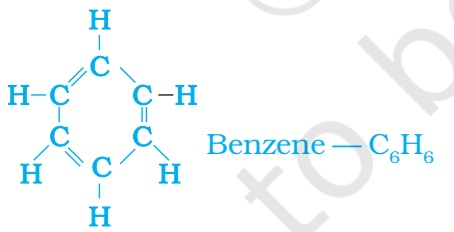

**But, let us take another look at butane. If we make the carbon ‘skeleton’ with four carbon atoms, we see that two different possible ‘skeletons’ are –**

Figure 4.8 (a) Two possible carbon-skeletons

**Filling the remaining valencies with hydrogen gives us –**

Figure 4.8 (b) Complete molecules for two structures with formula $\mathrm { C _ { 4 } H _ { 1 0 } }$

**We see that both these structures have the same formula** $\mathrm { C _ { 4 } H _ { 1 0 ^ { \circ } } }$ **Such compounds with identical molecular formula but different structures are called structural isomers.**

**In addition to straight and branched carbon chains, some compounds have carbon atoms arranged in the form of a ring. For example, cyclohexane has the formula** $\mathrm { C _ { 6 } H _ { 1 2 } }$ **and the following structure –**

(a)

(b)

Figure 4.9 Structure of cyclohexane (a) carbon skeleton (b) complete molecule

**Can you draw the electron dot structure for cyclohexane? Straight chain, branched chain and cyclic carbon compounds, all may be saturated** or unsaturated. For example, benzene**,** $\mathrm { C _ { 6 } H _ { 6 } , }$ **has the following structure –**

Figure 4.10 Structure of benzene

**All these carbon compounds which contain only carbon and hydrogen are called hydrocarbons. Among these, the saturated hydrocarbons are called alkanes. The unsaturated hydrocarbons which contain one or more double bonds are called alkenes. Those containing one or more triple bonds are called alkynes.**

## 4.2.3 Will you be my Friend?

**Carbon seems to be a very friendly element. So far we have been looking at compounds containing carbon and hydrogen only. But carbon also forms**