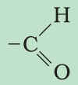
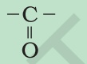
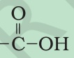

**bonds with other elements such as halogens, oxygen, nitrogen and sulphur. In a hydrocarbon chain, one or more hydrogens can be replaced by these elements, such that the valency of carbon remains satisfied. In such compounds, the element replacing hydrogen is referred to as a heteroatom. These heteroatoms are also present in some groups as given in Table 4.3.**

Table 4.3 Some functional groups in carbon compounds

<table><tr><td>Hetero atom</td><td>Class of compounds</td><td>Formula of functional group</td><td>the group containing these confer specific properties to the</td></tr><tr><td>Cl/Br</td><td>Halo- (Chloro/bromo) alkane</td><td> $—  Cl ,  —  Br$  (substitutes for hydrogen atom)</td><td>compound, regardless of the length and nature of the carbon chain and hence called are</td></tr><tr><td rowspan="4">Oxygen</td><td>1. Alcohol</td><td>-OH</td><td>functional groups. Some important functional groups are given in the</td></tr><tr><td>2. Aldehyde</td><td></td><td>Table 4.3. Free valency or valencies of the group are shown by the single</td></tr><tr><td>3. Ketone</td><td></td><td>line. The functional group is attached to the carbon through this chain</td></tr><tr><td>4. Carboxylic acid</td><td></td><td>valency by replacing one hydrogen atom or atoms.</td></tr></table>

## 4.2.4 Homologous Series

**You have seen that carbon atoms can be linked together to form chains of varying lengths. These chains can be branched also. In addition, hydrogen atom or other atoms on these carbon chains can be replaced by any of the functional groups that we saw above. The presence of a functional group such as alcohol decides the properties of the carbon compound, regardless of the length of the carbon chain. For example, the chemical properties of** $\mathrm{CH_{3}OH,C_{2}H_{5}OH,C_{3}H_{7}OH}$ **and** $\mathrm{C_{4}H_{9}OH}$ **are all very similar. Hence, such a series of compounds in which the same functional group substitutes for hydrogen in a carbon chain is called a homologous series.**

**Let us look at the homologous series that we saw earlier in Table 4.2. If we look at the formulae of successive compounds, say –**

$$
\begin{array} { r l r } { \mathrm { C H } _ { 4 }   \mathrm { \bar { a n d } }   \mathrm { C } _ { 2 } \mathrm { H } _ { 6 } } & { { } \mathrm { ~ \bar { ~ } ~ - ~ } } & { \mathrm { t h e s e ~ d i f f e r ~ b y ~ a - } \mathrm { C H } _ { 2 } \mathrm { \bar { ~ } u n i t } } \\ { \mathrm { C } _ { 2 } \mathrm { H } _ { 6 }   \mathrm { a n d }   \mathrm { C } _ { 3 } \mathrm { H } _ { 8 } } & { { } \mathrm { ~ \bar { ~ } ~ - ~ } } & { \mathrm { t h e s e ~ d i f f e r ~ b y ~ a - } \mathrm { C H } _ { 2 } \mathrm { \bar { ~ } u n i t } } \end{array}
$$

What is the difference between the next pair – propane and butane $( \mathrm { C _ { 4 } H _ { 1 0 } } ) ?$

**Can you find out the difference in molecular masses between these pairs (the atomic mass of carbon is 12 u and the atomic mass of hydrogen is 1 u)?**

**Similarly, take the homologous series for alkenes. The first member of the series is ethene which we have already come across in Section 4.2.1. What is the formula for ethene? The succeeding members** have the formula $\mathrm { C _ { 3 } H _ { 6 } , C _ { 4 } H _ { 8 } }$ and $\mathrm { C _ { 5 } H _ { 1 0 } }$ . Do these also differ by $\mathrm { a   -   C H _ { 2 } - }$