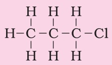
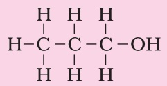
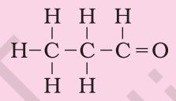
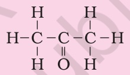
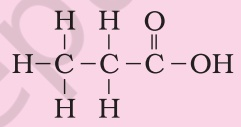

Table 4.4 Nomenclature of organic compounds

<table><tr><td>Class ofcompounds</td><td>Prefix/Suffix</td><td>Example</td></tr><tr><td>1. Halo alkane</td><td>Prefix-chloro,bromo, etc.</td><td>             Chloropropane</td></tr><tr><td></td><td></td><td> $\mathrm { H } { - } \overset { \overset { \mathrm { H } } { \vert } } { \underset { \mathrm { H } } { \overset { \vert } { \mathrm { C } } } } { - } \overset { \overset { \mathrm { H } } { \vert } } { \underset { \mathrm { H } } { \overset { \vert } { \mathrm { C } } } } { - } \overset { \overset { \mathrm { H } } { \vert } } { \underset { \mathrm { H } } { \overset { \vert } { \mathrm { C } } } } { - } \mathrm { B r }$   Bromopropane</td></tr><tr><td>2. Alcohol</td><td>Suffix - ol</td><td>            Propanol</td></tr><tr><td>3. Aldehyde</td><td>Suffix - al</td><td>             Propanal</td></tr><tr><td>4. Ketone</td><td>Suffix - one</td><td>             Propanone</td></tr><tr><td>5. Carboxylic acid</td><td>Suffix - oic acid</td><td>             Propanoic acid</td></tr><tr><td>6. Alkenes</td><td> ${ \mathrm { S u f f i x ~ - ~ e n e } }$ </td><td> $\stackrel { \mathrm { H } } { \underset { \mathrm { H } } { \mathrm { H } } - \stackrel { \mathrm { C } } { \underset { \mathrm { \tiny ~ | ~ } } { \mathrm { C } } } - \stackrel { \mathrm { H } } { \underset { \mathrm { \tiny ~ \mathrm { C } } } { \mathrm { \tiny ~ | ~ } } } } = \stackrel { \mathrm { H } } { \underset { \mathrm { H } } { \mathrm { C } } } \stackrel { \mathrm { H } } { \underset { \mathrm { H } } { \mathrm { \tiny ~ | ~ } } }$    Propene</td></tr><tr><td>7. Alkynes</td><td>Suffix yne</td><td> $\stackrel { \mathrm { H } } { \underset { \mathrm { H } } { \mathrm { H } } - \stackrel { \mathrm { C } } { \underset { \mathrm { \tiny ~ \vert ~ } } { \mathrm { C } } } - \mathrm { C } } \equiv \mathrm { C } - \mathrm { H }$    Propyne</td></tr></table>

| Q U E S T I O N S |
| --- |
| 1. How many structural isomers can you draw for pentane? 2. What are the two properties of carbon which lead to the huge number of carbon compounds we see around us? 3. What will be the formula and electron dot structure of cyclopentane? |