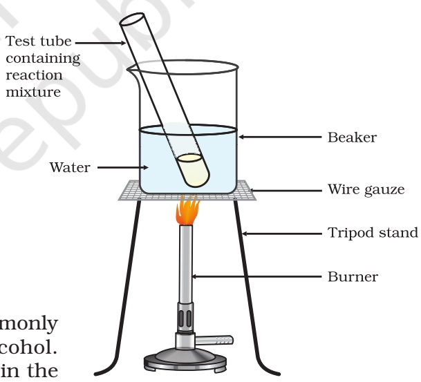

**Alcohol as a fuel**

**Sugarcane plants are one of the most efficient convertors of sunlight into chemical energy. Sugarcane juice can be used to prepare molasses which is fermented to give alcohol (ethanol). Some countries now use alcohol as an additive in petrol since it is a cleaner fuel which gives rise to only carbon dioxide and water on burning in sufficient air (oxygen).**

## 4.4.2 Properties of Ethanoic Acid

**Ethanoic acid is commonly called acetic acid and belongs to a group of acids called carboxylic acids. 5-8% solution of acetic acid in water is called vinegar and is used widely as a preservative in pickles. The melting point of pure ethanoic acid is 290 K and hence it often freezes during winter in cold climates. This gave rise to its name glacial acetic acid.**

**The group of organic compounds called carboxylic acids are obviously characterised by their acidic nature. However, unlike mineral acids like HCl, which are completely ionised, carboxylic acids are weak acids.**

## Activity 4.8

**Take 1 mL ethanol (absolute alcohol) and 1 mL glacial acetic acid along with a few drops of concentrated sulphuric acid in a test tube.**

**Warm in a water-bath for at least five minutes as shown in Fig. 4.11.**

**Pour into a beaker containing 20-50 mL of water and smell the resulting mixture.**

**Compare the pH of dilute acetic acid and dilute hydrochloric acid using both litmus paper and universal indicator.**

**Are both acids indicated by the litmus test?**

## Activity 4.7

## Reactions of ethanoic acid:

**Does the universal indicator show them as equally strong acids?**

**(i) Esterification reaction: Esters are most commonly formed by reaction of an acid and an alcohol. Ethanoic acid reacts with absolute ethanol in the presence of an acid catalyst to give an ester –**

Figure 4.11 Formation of ester

$$
\mathrm{CH_{3}-COOH+CH_{3}}
$$

$$
\mathrm{^{\mathrm{P}}CH_{2}OH\underset{\mathrm{O}}{\overset{\mathrm{Acid}}{\rightleftharpoons}} CH_{3}-\underset{\mathrm{O}}{\overset{\mathrm{C}}{\rightleftharpoons}}-\mathrm{O}-CH_{2}-CH_{3}+H_{2}O}
$$

(Ethanoic acid)

(Ethanol)

(Ester)

**Generally, esters are sweet-smelling substances. These are used in making perfumes and as flavouring agents. On treating with sodium hydroxide, which is an alkali, the ester is converted back to alcohol and sodium salt of carboxylic acid. This reaction is known as saponification because it is used in the preparation of soap. Soaps are sodium or potassium salts of long chain carboxylic acid.**