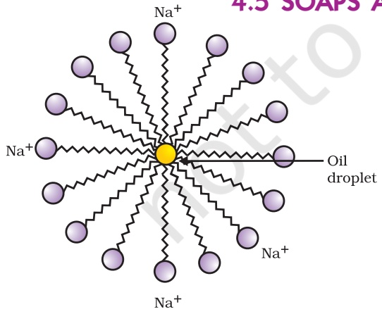

$$
\mathrm{CH_{3}COOC_{2}H_{5}}\xrightarrow{\mathrm{NaOH}}\mathrm{C_{2}H_{5}OH}+\mathrm{CH_{3}COONa}
$$

**(ii) Reaction with a base: Like mineral acids, ethanoic acid reacts with a base such as sodium hydroxide to give a salt (sodium ethanoate or commonly called sodium acetate) and water:**

$$
\mathrm{NaOH}+\mathrm{CH_{3}COOH}\rightarrow\mathrm{CH_{3}COONa}+\mathrm{H_{2}O}
$$

**How does ethanoic acid react with carbonates and hydrogencarbonates?**

**Let us perform an activity to find out.**

## Activity 4.9

n **Set up the apparatus as shown in Chapter 2, Activity 2.5.**

**Take a spatula full of sodium carbonate in a test tube and add 2 mL of dilute ethanoic acid.**

n **What do you observe?**

n **Pass the gas produced through freshly prepared lime-water. What do you observe?**

**Can the gas produced by the reaction between ethanoic acid and sodium carbonate be identified by this test?**

n **Repeat this Activity with sodium hydrogencarbonate instead of sodium carbonate.**

**(iii) Reaction with carbonates and hydrogencarbonates: Ethanoic acid reacts with carbonates and hydrogencarbonates to give rise to a salt, carbon dioxide and water. The salt produced is commonly called sodium acetate.**

$$
2CH_{3}COOH + Na_{2}CO_{3} \rightarrow 2CH_{3}COONa + H_{2}O + CO_{2}
$$

$$
\mathrm{CH_{3}COOH + [NaHCO_{3} \rightarrow CH_{3}COONa + H_{2}O + CO_{2}]}
$$

## Q U E S T I O N S

**1. How would you distinguish experimentally between an alcohol and a carboxylic acid?**

**2. What are oxidising agents?**

## 4.5 SOAPS AND DETERGENTS

Figure 4.12

Formation of micelles

## Activity 4.10

n **Take about 10 mL of water each in two test tubes.**

**Add a drop of oil (cooking oil) to both the test tubes and label them as A and B.**

n **To test tube B, add a few drops of soap solution.**

**Now shake both the test tubes vigourously for the same period of time.**

**Can you see the oil and water layers separately in both the test tubes immediately after you stop shaking them?**

**Leave the test tubes undisturbed for some time and observe. Does the oil layer separate out? In which test tube does this happen first?**