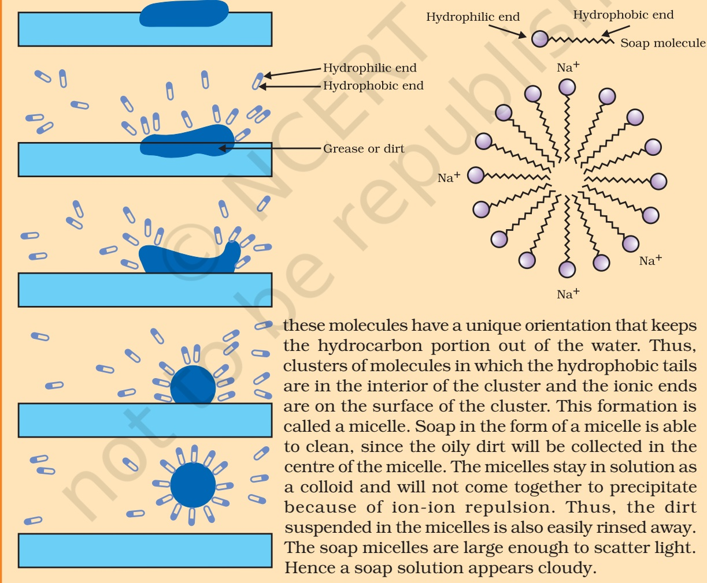

**This activity demonstrates the effect of soap in cleaning. Most dirt is oily in nature and as you know, oil does not dissolve in water. The molecules of soap are sodium or potassium salts of long-chain carboxylic acids. The ionic-end of soap interacts with water while the carbon chain interacts with oil. The soap molecules, thus form structures called micelles (see Fig. 4.12) where one end of the molecules is towards the oil droplet while the ionic-end faces outside. This forms an emulsion in water. The soap micelle thus helps in pulling out the dirt in water and we can wash our clothes clean (Fig. 4.13).**

**Can you draw the structure of the micelle that would be formed if you dissolve soap in a hydrocarbon?**

**Micelles**

**Soaps are molecules in which the two ends have differing properties, one is hydrophilic, that is, it interacts with water, while the other end is hydrophobic, that is, it interacts with hydrocarbons. When soap is at the surface of water, the hydrophobic ‘tail’ of soap will not be soluble in water and the soap will align along the surface of water with the ionic end in water and the hydrocarbon ‘tail’ protruding out of water. Inside water,**

**these molecules have a unique orientation that keeps the hydrocarbon portion out of the water. Thus, clusters of molecules in which the hydrophobic tails are in the interior of the cluster and the ionic ends are on the surface of the cluster. This formation is called a micelle. Soap in the form of a micelle is able to clean, since the oily dirt will be collected in the centre of the micelle. The micelles stay in solution as a colloid and will not come together to precipitate because of ion-ion repulsion. Thus, the dirt suspended in the micelles is also easily rinsed away. The soap micelles are large enough to scatter light. Hence a soap solution appears cloudy.**

Figure 4.13 Effect of soap in cleaning