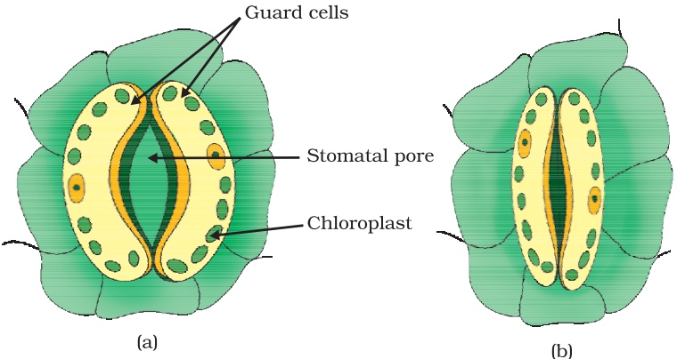
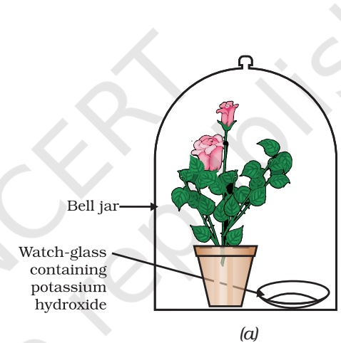
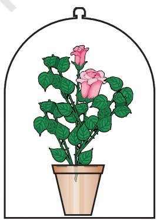

**Now, let us study how the plant obtains carbon dioxide. In Class IX, we had talked about stomata (Fig. 5.3) which are tiny pores present on the surface of the leaves. Massive amounts of gaseous exchange takes place in the leaves through these pores for the purpose of photosynthesis. But it is important to note here that exchange of gases occurs across the surface of stems, roots and leaves as well. Since large amounts of water can also be lost through these stomata, the plant closes these pores when it does not**

Figure 5.3 (a) Open and (b) closed stomatal pore

**need carbon dioxide for photosynthesis. The opening and closing of the pore is a function of the guard cells. The guard cells swell when water flows into them, causing the stomatal pore to open. Similarly the pore closes if the guard cells shrink.**

## Activity 5.2

**Take two healthy potted plants which are nearly the same size.**

**Keep them in a dark room for three days.**

**Now place each plant on separate glass plates. Place a watch-glass containing potassium hydroxide by the side of one of the plants. The potassium hydroxide is used to absorb carbon dioxide.**

**Cover both plants with separate bell-jars as shown in Fig. 5.4.**

**Use vaseline to seal the bottom of the jars to the glass plates so that the set-up is air-tight.**

**Keep the plants in sunlight for about two hours.**

(b)

Figure 5.4 Experimental set-up (a) with potassium hydroxide (b) without potassium hydroxide

n **Pluck a leaf from each plant and check for the presence of starch as in the above activity.**

n **Do both the leaves show the presence of the same amount of starch?**

n **What can you conclude from this activity?**

**Based on the two activities performed above, can we design an experiment to demonstrate that sunlight is essential for photosynthesis?**

**So far, we have talked about how autotrophs meet their energy requirements. But they also need other raw materials for building their body. Water used in photosynthesis is taken up from the soil by the roots in terrestrial plants. Other materials like nitrogen, phosphorus, iron and magnesium are taken up from the soil. Nitrogen is an essential element used in the synthesis of proteins and other compounds. This is**