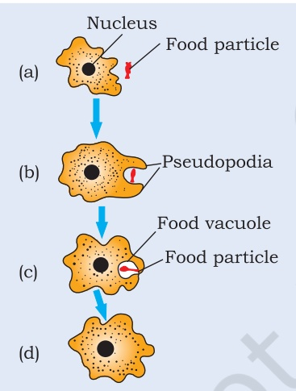

**taken up in the form of inorganic nitrates or nitrites. Or it is taken up as organic compounds which have been prepared by bacteria from atmospheric nitrogen.**

## 5.2.2 Heterotrophic Nutrition

**Each organism is adapted to its environment. The form of nutrition differs depending on the type and availability of food material as well as how it is obtained by the organism. For example, whether the food source is stationary (such as grass) or mobile (such as a deer), would allow for differences in how the food is accessed and what is the nutritive apparatus used by a cow and a lion. There is a range of strategies by which the food is taken in and used by the organism. Some organisms break-down the food material outside the body and then absorb it. Examples are fungi like bread moulds, yeast and mushrooms. Others take in whole material and break it down inside their bodies. What can be taken in and broken down depends on the body design and functioning. Some other organisms derive nutrition from plants or animals without killing them. This parasitic nutritive strategy is used by a wide variety of organisms like cuscuta (amar-bel), ticks, lice, leeches and tape-worms.**

## 5.2.3 How do Organisms obtain their Nutrition?

Figure 5.5 Nutrition in Amoeba

e the food and the way it is obtained differ, the digestive system is **different in various organisms. In single-celled organisms, the food may be taken in by the entire surface. But as the complexity of the organism increases, different parts become specialised to perform different functions. For example, Amoeba takes in food using temporary finger-like extensions of the cell surface which fuse over the food particle forming a food-vacuole (Fig. 5.5). Inside the foodvacuole, complex substances are broken down into simpler ones which then diffuse into the cytoplasm. The remaining undigested material is moved to the surface of the cell and thrown out. In Paramoecium, which is also a unicellular organism, the cell has a definite shape and food is taken in at a specific spot. Food is moved to this spot by the movement of cilia which cover the entire surface of the cell.**

## 5.2.4 Nutrition in Human Beings

**The alimentary canal is basically a long tube extending from the mouth to the anus. In Fig. 5.6, we can see that the tube has different parts. Various regions are specialised to perform different functions. What happens to the food once it enters our body? We shall discuss this process here.**