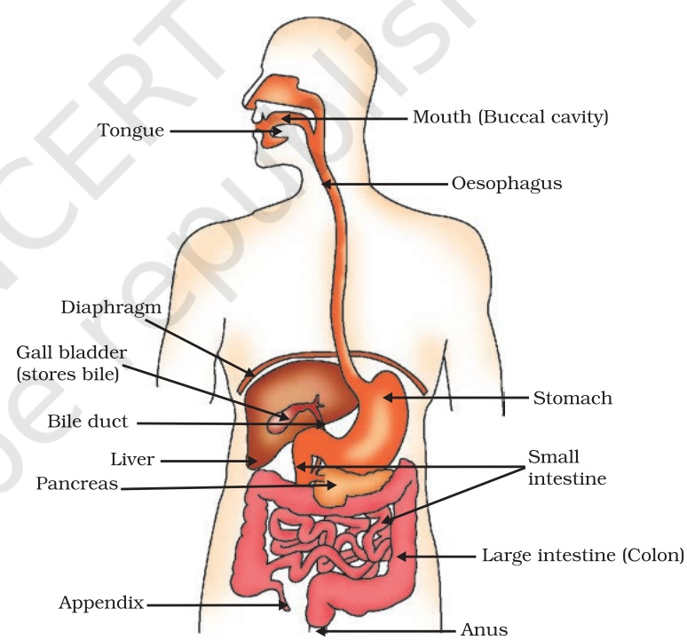

## Activity 5.3

n **Take 1 mL starch solution (1%) in two test tubes (A and B).**

**Add 1 mL saliva to test tube A and leave both test tubes undisturbed for 20-30 minutes.**

n **Now add a few drops of dilute iodine solution to the test tubes.**

n **In which test tube do you observe a colour change?**

**What does this indicate about the presence or absence of starch in the two test tubes?**

n **What does this tell us about the action of saliva on starch?**

**We eat various types of food which has to pass through the same digestive tract. Naturally the food has to be processed to generate particles which are small and of the same texture. This is achieved by crushing the food with our teeth. Since the lining of the canal is soft, the food is also wetted to make its passage smooth. When we eat something we like, our mouth ‘waters’. This is actually not only water, but a fluid called saliva secreted by the salivary glands. Another aspect of the food we ingest is its complex nature. If it is to be absorbed from the alimentary canal, it has to be broken into smaller molecules. This is done with the**

**help of biological catalysts called enzymes. The saliva contains an enzyme called salivary amylase that breaks down starch which is a complex molecule to give simple sugar. The food is mixed thoroughly with saliva and moved around the mouth while chewing by the muscular tongue.**

**It is necessary to move the food in a regulated manner along the digestive tube so that it can be processed properly in each part. The lining of canal has muscles that contract rhythmically in order to push the food forward. These peristaltic movements occur all along the gut.**

**From the mouth, the food is taken to the stomach through the food-pipe or oesophagus. The stomach is a large organ which expands when food enters it. The muscular walls of the stomach help in mixing the food thoroughly with more digestive juices.**

Figure 5.6 Human alimentary canal

**The digestion in stomach is taken**

**care of by the gastric glands present in the wall of the stomach. These release hydrochloric acid, a protein digesting enzyme called pepsin, and mucus. The hydrochloric acid creates an acidic medium which facilitates the action of the enzyme pepsin. What other function do you think is served by the acid? The mucus protects the inner lining of the stomach from the action of the acid under normal conditions. We**