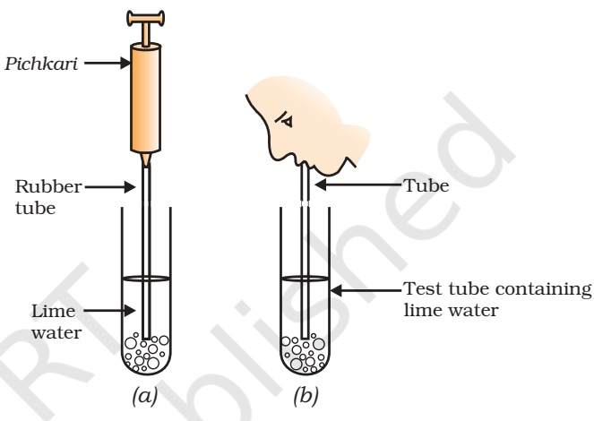

**1. What are the differences between autotrophic nutrition and heterotrophic nutrition?**

**2. Where do plants get each of the raw materials required for photosynthesis?**

**3. What is the role of the acid in our stomach?**

**4. What is the function of digestive enzymes?**

**5. How is the small intestine designed to absorb digested food?**

## 5.3 RESPIRATION

## Activity 5.4

**Take some freshly prepared lime water in a test tube.**

n **Blow air through this lime water.**

**Note how long it takes for the lime water to turn milky.**

**Use a syringe or pichkari to pass air through some fresh lime water taken in another test tube (Fig. 5.7).**

**Note how long it takes for this lime water to turn milky.**

**What does this tell us about the amount of carbon dioxide in the air that we breathe out?**

Figure 5.7

(a) Air being passed into lime water with a pichkari/ syringe, (b) air being exhaled into lime water

## Activity 5.5

**Take some fruit juice or sugar solution and add some yeast to this. Take this mixture in a test tube fitted with a one-holed cork.**

**Fit the cork with a bent glass tube. Dip the free end of the glass tube into a test tube containing freshly prepared lime water.**

**What change is observed in the lime water and how long does it take for this change to occur?**

**What does this tell us about the products of fermentation?**

**We have discussed nutrition in organisms in the last section. The food material taken in during the process of nutrition is used in cells to provide energy for various life processes. Diverse organisms do this in different ways – some use oxygen to break-down glucose completely into carbon dioxide and water, some use other pathways that do not involve oxygen (Fig. 5.8). In all cases, the first step is the break-down of glucose, a six-carbon molecule, into a three-carbon molecule called pyruvate. This process takes place in the cytoplasm. Further, the pyruvate may be converted into ethanol and carbon dioxide. This process takes place in yeast during fermentation. Since this process takes place in the absence of air (oxygen), it is called anaerobic respiration. Breakdown of pyruvate using oxygen takes place in the mitochondria. This**