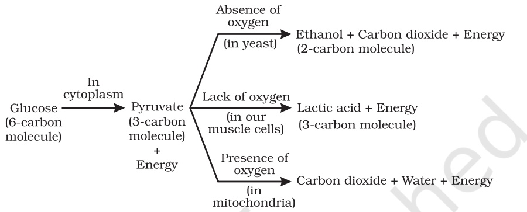

**process breaks up the three-carbon pyruvate molecule to give three molecules of carbon dioxide. The other product is water. Since this process takes place in the presence of air (oxygen), it is called aerobic respiration. The release of energy in this aerobic process is a lot greater than in the anaerobic process. Sometimes, when there is a lack of oxygen in our muscle cells, another pathway for the break-down of pyruvate is taken. Here the pyruvate is converted into lactic acid which is also a three-carbon molecule. This build-up of lactic acid in our muscles during sudden activity causes cramps.**

Figure 5.8 Break-down of glucose by various pathways

**The energy released during cellular respiration is immediately used to synthesise a molecule called ATP which is used to fuel all other activities in the cell. In these processes, ATP is broken down giving rise to a fixed amount of energy which can drive the endothermic reactions taking place in the cell.**

**ATP**

**ATP is the energy currency for most cellular processes. The energy released during the process of respiration is used to make an ATP molecule from ADP and inorganic phosphate.**

$$
\mathrm{ADP}+\textcircled{P} \xrightarrow{ Energy } \mathrm{ ADP} \sim \textcircled{P} = \mathrm{ATP}
$$

## P:Phosphate

**Endothermic processes in the cell then use this ATP to drive the reactions. When the terminal phosphate linkage in ATP is broken using water, the energy equivalent to 30.5 kJ/mol is released.**

**Think of how a battery can provide energy for many different kinds of uses. It can be used to obtain mechanical energy, light energy, electrical energy and so on. Similarly, ATP can be used in the cells for the contraction of muscles, protein synthesis, conduction of nervous impulses and many other activities.**

**Since the aerobic respiration pathway depends on oxygen, aerobic organisms need to ensure that there is sufficient intake of oxygen. We have seen that plants exchange gases through stomata, and the large inter-cellular spaces ensure that all cells are in contact with air. Carbon dioxide and oxygen are exchanged by diffusion here. They can go into**