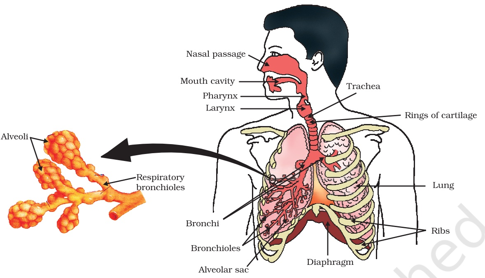

Figure 5.9 Human respiratory system

## Do You Know?

**Smoking is injurious to health.**

**Lung cancer is one of common causes of deaths in the world. The upper part of respiratory tract is provided with small hair -like structures called cilia. These cilia help to remove germs, dust and other harmful particles from inhaled air. Smoking destroys these hair due to which germs, dust, smoke and other harmful chemicals enter lungs and cause infection, cough and even lung cancer.**

**Within the lungs, the passage divides into smaller and smaller tubes which finally terminate in balloon-like structures which are called alveoli (singular–alveolus). The alveoli provide a surface where the exchange of gases can take place. The walls of the alveoli contain an extensive network of blood-vessels. As we have seen in earlier years, when we breathe in, we lift our ribs and flatten our diaphragm, and the chest cavity becomes larger as a result. Because of this, air is sucked into the lungs and fills the expanded alveoli. The blood brings carbon dioxide from the rest of the body for release into the alveoli, and the oxygen in the alveolar air is taken up by blood in the alveolar blood vessels to be transported to all the cells in the body. During the breathing cycle, when air is taken in and let out, the lungs always contain a residual volume of air so that there is sufficient time for oxygen to be absorbed and for the carbon dioxide to be released.**

**When the body size of animals is large, the diffusion pressure alone cannot take care of oxygen delivery to all parts of the body. Instead, respiratory pigments take up oxygen from the air in the lungs and carry it to tissues which are deficient in oxygen before releasing it. In human beings, the respiratory pigment is haemoglobin which has a very high affinity for oxygen. This pigment is present in the red blood corpuscles. Carbon dioxide is more soluble in water than oxygen is and hence is mostly transported in the dissolved form in our blood.**