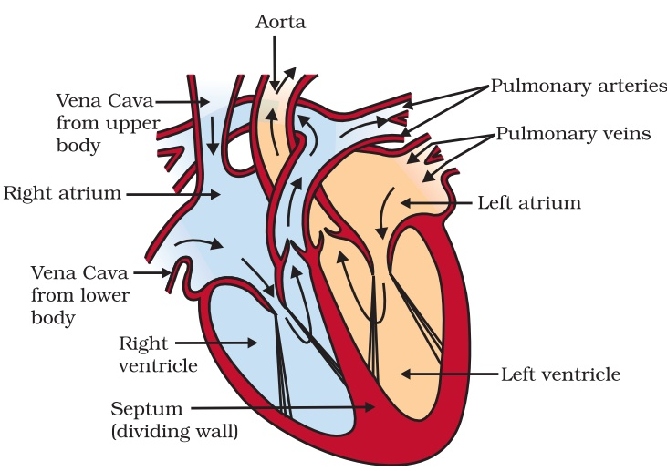
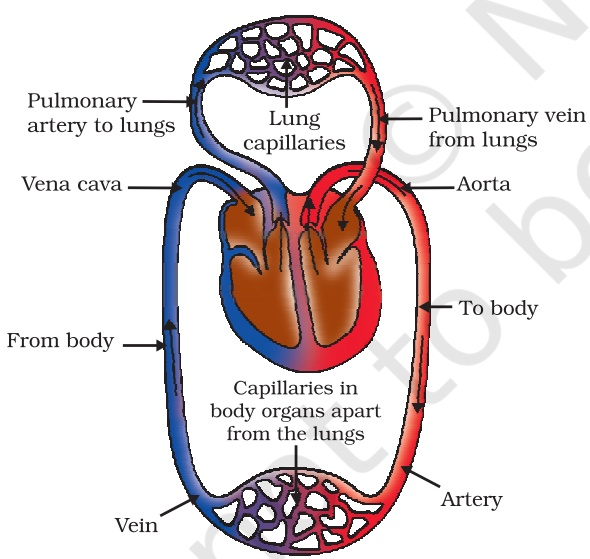

Figure 5.10 Schematic sectional view of the human heart

## Our pump — the heart

**The heart is a muscular organ which is as big as our fist (Fig. 5.10). Because both oxygen and carbon dioxide have to be transported by the blood, the heart has different chambers to prevent the oxygen-rich blood from mixing with the blood containing carbon dioxide. The carbon dioxide-rich blood has to reach the lungs for the carbon dioxide to be removed, and the oxygenated blood from the lungs has to be brought back to the heart. This oxygen-rich blood is then pumped to the rest of the body.**

**We can follow this process step by step (Fig. 5.11). Oxygen-rich blood from the lungs comes to the thin-walled upper** **chamber of the heart on the left, the left atrium. The left atrium relaxes when it is collecting this blood. It then contracts, while the next chamber, the left ventricle, relaxes, so that the blood is transferred to it. When the muscular left ventricle contracts in its turn, the blood is pumped out to the body. De-oxygenated blood comes from the body to the upper chamber on the right, the right atrium, as it relaxes. As the right atrium contracts, the corresponding lower chamber, the right ventricle, dilates. This transfers blood to the right ventricle, which in turn pumps it to the lungs for oxygenation. Since ventricles have to pump blood into various organs, they have thicker muscular walls than the atria do. Valves ensure that blood does not flow backwards when the atria or ventricles contract.**

Figure 5.11

Schematic representation of transport and exchange of oxygen and carbon dioxide

## Oxygen enters the blood in the lungs

**The separation of the right side and the left side of the heart is useful to keep oxygenated and deoxygenated blood from mixing. Such separation allows a highly efficient supply of oxygen to the body. This is useful in animals that have high energy needs, such as birds and mammals, which constantly use energy to maintain their body temperature. In animals that do not use energy for this purpose, the body temperature depends on the temperature in the environment. Such animals, like amphibians or many reptiles have three-chambered hearts, and tolerate some mixing of the oxygenated and de-oxygenated blood streams. Fishes, on the other hand, have only two chambers to their hearts, and the blood is pumped to the gills, is oxygenated there, and passes directly to the rest of the body. Thus, blood goes only once through the heart in the fish during one cycle of** **passage through the body. On the other hand, it goes through the heart twice during each cycle in other vertebrates. This is known as double circulation.**