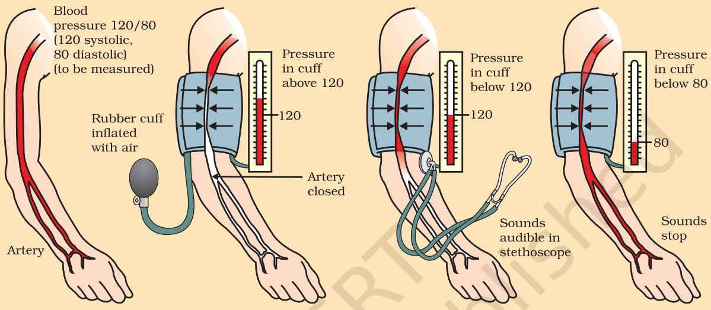

Blood pressure is measured with an instrument called sphygmomanometer. High blood pressure is also called hypertension and is caused by the constriction of arterioles, which results in increased resistance to blood flow. It can lead to the rupture of an artery and internal bleeding.

**Blood pressure**

**The force that blood exerts against the wall of a vessel is called blood pressure. This pressure is much greater in arteries than in veins. The pressure of blood inside the artery during ventricular systole (contraction) is called systolic pressure and pressure in artery during ventricular diastole (relaxation) is called diastolic pressure. The normal systolic pressure is about 120 mm of Hg and diastolic pressure is 80 mm of Hg.**

## The tubes – blood vessels

**Arteries are the vessels which carry blood away from the heart to various organs of the body. Since the blood emerges from the heart under high pressure, the arteries have thick, elastic walls. Veins collect the blood from different organs and bring it back to the heart. They do not need thick walls because the blood is no longer under pressure, instead they have valves that ensure that the blood flows only in one direction.**

**On reaching an organ or tissue, the artery divides into smaller and smaller vessels to bring the blood in contact with all the individual cells. The smallest vessels have walls which are one-cell thick and are called capillaries. Exchange of material between the blood and surrounding cells takes place across this thin wall. The capillaries then join together to form veins that convey the blood away from the organ or tissue.**

## Maintenance by platelets

**What happens if this system of tubes develops a leak? Think about situations when we are injured and start bleeding. Naturally the loss of blood from the system has to be minimised. In addition, leakage would lead to a loss of pressure which would reduce the efficiency of the**