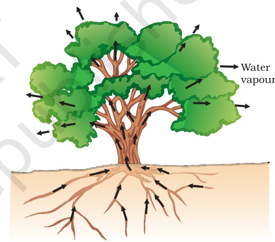

**moves into the root from the soil to eliminate this difference. This means that there is steady movement of water into root xylem, creating a column of water that is steadily pushed upwards.**

**However, this pressure by itself is unlikely to be enough to move water over the heights that we commonly see in plants. Plants use another strategy to move water in the xylem upwards to the highest points of the plant body.**

## Activity 5.8

**Take two small pots of approximately the same size and having the same amount of soil. One should have a plant in it. Place a stick of the same height as the plant in the other pot.**

**Cover the soil in both pots with a plastic sheet so that moisture cannot escape by evaporation.**

**Cover both sets, one with the plant and the other with the stick, with plastic sheets and place in bright sunlight for half an hour.**

n **Do you observe any difference in the two cases?**

**Provided that the plant has an adequate supply of water, the water which is lost through the stomata is replaced by water from the xylem vessels in the leaf. In fact, evaporation of water molecules from the cells of a leaf creates a suction which pulls water from the xylem cells of roots. The loss of water in the form of vapour from the aerial parts of the plant is known as transpiration.**

**Thus, transpiration helps in the absorption and upward movement of water and minerals dissolved in it from roots to the leaves. It also helps in temperature regulation. The effect of root pressure in transport of water is more important at night. During the day when the stomata are open, the transpiration pull becomes the major driving force in the movement of water in the xylem.**

Figure 5.12

Movement of water during transpiration in a tree

## Transport of food and other substances

**So far we have discussed the transport of water and minerals in plants. Now let us consider how the products of metabolic processes, particularly photosynthesis, are moved from leaves, where they are formed, to other parts of the plant. This transport of soluble products of photosynthesis is called translocation and it occurs in the part of the vascular tissue known as phloem. Besides the products of photosynthesis, the phloem transports amino acids and other substances. These substances are especially delivered to the storage organs of roots, fruits and seeds and to growing organs. The translocation of food and other substances takes place in the sieve tubes with the help of adjacent companion cells both in upward and downward directions.**

**Unlike transport in xylem which can be largely explained by simple physical forces, the translocation in phloem is achieved by utilising**