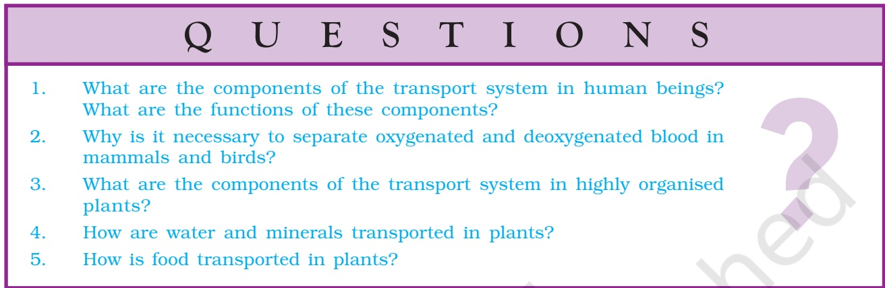
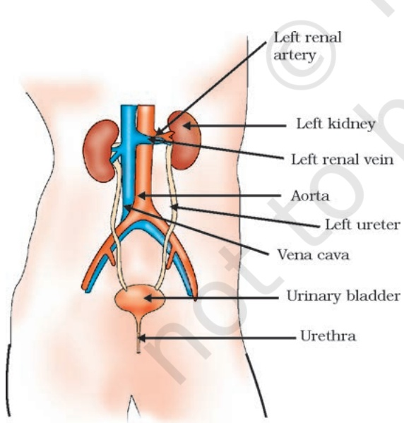

**energy. Material like sucrose is transferred into phloem tissue using energy from ATP. This increases the osmotic pressure of the tissue causing water to move into it. This pressure moves the material in the phloem to tissues which have less pressure. This allows the phloem to move material according to the plant’s needs. For example, in the spring, sugar stored in root or stem tissue would be transported to the buds which need energy to grow.**

## 5.5 EXCRETION

**We have already discussed how organisms get rid of gaseous wastes generated during photosynthesis or respiration. Other metabolic activities generate nitrogenous materials which need to be removed. The biological process involved in the removal of these harmful metabolic wastes from the body is called excretion. Different organisms use varied strategies to do this. Many unicellular organisms remove these wastes by simple**

Figure 5.13

Excretory system in human beings

**diffusion from the body surface into the surrounding water. As we have seen in other processes, complex multi-cellular organisms use specialised organs to perform the same function.**

## 5.5.1 Excretion in Human Beings

**The excretory system of human beings (Fig. 5.13) includes a pair of kidneys, a pair of ureters, a urinary bladder and a urethra. Kidneys are located in the abdomen, one on either side of the backbone. Urine produced in the kidneys passes through the ureters into the urinary bladder where it is stored until it is released through the urethra.**

**How is urine produced? The purpose of making urine is to filter out waste products from the blood.** Just as $\mathrm { C O _ { 2 } }$ **is removed from the blood in the lungs, nitrogenous waste such as urea or uric acid are removed from blood in the kidneys. It is then no surprise that the basic filtration unit in the kidneys,**