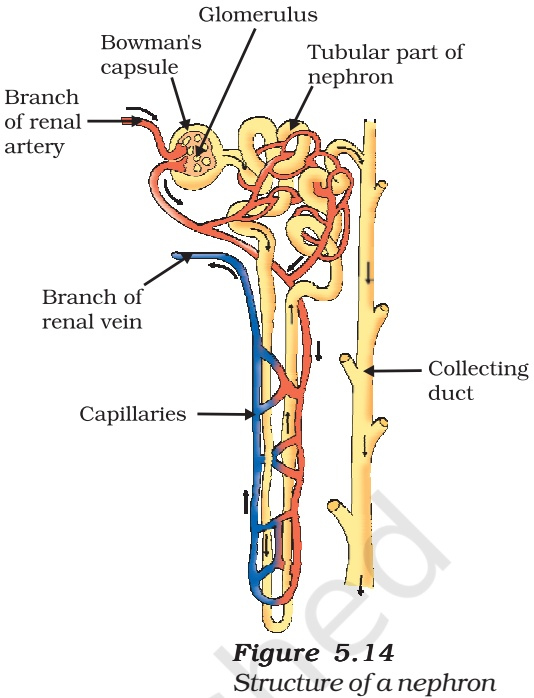
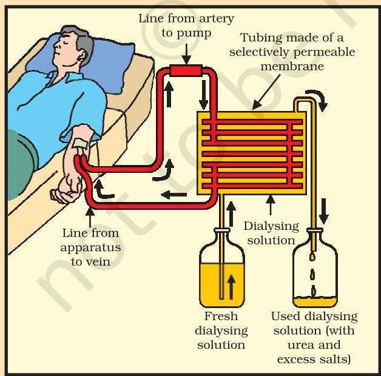

**like in the lungs, is a cluster of very thin-walled blood capillaries. Each capillary cluster in the kidney is associated with the cup-shaped end of a coiled tube called Bowman’s capsule that collects the filtrate (Fig. 5.14). Each kidney has large numbers of these filtration units called nephrons packed close together. Some substances in the initial filtrate, such as glucose, amino acids, salts and a major amount of water, are selectively re-absorbed as the urine flows along the tube. The amount of water re-absorbed depends on how much excess water there is in the body, and on how much of dissolved waste there is to be excreted. The urine forming in each kidney eventually enters a long tube, the ureter, which connects the kidneys with the urinary bladder. Urine is stored in the urinary bladder until the pressure of the expanded bladder leads to the urge to pass it out through the urethra. The bladder is muscular, so it is under nervous control, as we have discussed elsewhere. As a result, we can usually control the urge to urinate.**

**Artificial kidney (Hemodialysis)**

**Kidneys are vital organs for survival. Several factors like infections, injury or restricted blood flow to kidneys reduce the activity of kidneys. This leads to accumulation of poisonous wastes in the body, which can even lead to death. In case of kidney failure, an artificial kidney can be used. An artificial kidney is a device to remove nitrogenous waste products from the blood through dialysis.**

**Artificial kidneys contain a number of tubes with a semi-permeable lining, suspended**

**in a tank filled with dialysing fluid. This fluid has the same osmotic pressure as blood, except that it is devoid of nitrogenous wastes. The patient’s blood is passed through these tubes. During this passage, the waste products from the blood pass into dialysing fluid by diffusion. The purified blood is pumped back into the patient. This is similar to the function of the kidney, but it is different since there is no reabsorption involved. Normally, in a healthy adult, the initial filtrate in the** kidneys is about 180 L daily **However, the volume actually excreted is only a litre or two a day, because the remaining filtrate is reabsorbed in the kidney tubules.**